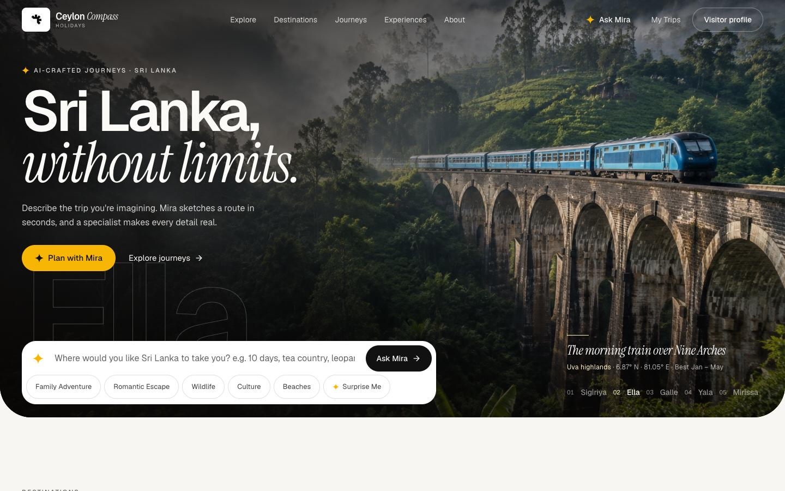

# Mira · Ceylon Compass Holidays

A fictional Sri Lanka travel concierge. Mira turns a conversation into published journeys, an itinerary excerpt, a workbook-verified quote when supported, or a private request for a specialist.

Start with “We have six days for nature, trains and beaches.” Select a day, set a departure, then ask “Add another day in Ella.” The itinerary is saved under My Trips. [Implementation and verification](docs/NOTEBOOK_DELIVERY.md)



## Start

Install Node.js 22+, npm, Python 3.13, `uv`, and `make`. Keep the supplied data folder next to this README. Run this from the workspace root.

```sh
make dev
```

Open the [integrated traveller workspace](http://127.0.0.1:5175/dump.html) (`http://127.0.0.1:5175/workspace/index.html`) for the preferred React/Tailwind Travel Workspace, or open the unified [Staff & Admin Console](http://127.0.0.1:5175/staff) (also served at `http://127.0.0.1:3000/staff`) for enquiries, internal finance, quote revisions, trace inspection, user role administration, and Approver-only content publishing. The command starts both frontends and the API. FastAPI listens on loopback port 8000. [Health](http://127.0.0.1:8000/api/health) and [OpenAPI](http://127.0.0.1:8000/docs) are available while it runs.

### Architecture & Demo Guide
- **Frontend:** `apps/ceylon-compass/workspace/Workspace.jsx` (preferred Travel Workspace + unified `StaffConsole.tsx`) and `apps/web` (editorial notebook).
- **Backend:** `apps/api/mira/` (FastAPI + 5-node LangGraph workflow + deterministic `Decimal` workbook pricing + SQLite persistence via Alembic `0006_enquiry_contact_fields`).
- **Demo Walkthrough:** See [docs/DEMO_CHECKLIST.md](docs/DEMO_CHECKLIST.md), [docs/system-audit/IMPLEMENTATION_REPORT.md](docs/system-audit/IMPLEMENTATION_REPORT.md), and [docs/system-audit/FINAL_VERIFICATION.md](docs/system-audit/FINAL_VERIFICATION.md).
- **Role Governance:** Only the `approver` role may review and publish AI content drafts; `admin` manages user roles in User Administration and cannot publish drafts directly.
- **Known Limitations & AI Disclosure:** Local SQLite database and simulated mock booking/payment endpoints are intended for local/assignment demonstration rather than multi-instance production hosting. Without `GEMINI_API_KEY`, Mira uses deterministic local rules and extractive drafts. When `GEMINI_API_KEY` is configured, prompts and published excerpts are sent to the configured Gemini model; pricing always remains 100% deterministic from `rate_sheet_2026-27.xlsx`.

The demo clock defaults to **19 November 2026**, matching the assessment. Try “Sigiriya day trip for two adults on 10 January 2027” or “Design a 10-day custom journey across Kandy and Ella for a family of four.” The booking form uses simulations and accepts no payment information.

Copy `.env.example` to `.env` to configure staff and providers. Generate a different long random value for each staff role with `openssl rand -hex 32` and paste that role’s token into Staff console. Roles and publication are enforced by the API. Gemini suggestions, Gemini draft generation and Langfuse export need their corresponding credentials. With no secrets, the app uses rule-based discovery, extractive drafts and SQLite trace stages.

`docker compose up --build` is included for Docker hosts. The workbook is mounted read-only. Docker was unavailable during host validation. To isolate fixtures or repeat the demo independently, set `MIRA_DB=/absolute/path/to/new-demo.sqlite3` before starting.

## Integrated assignment frontend

The supplied HTML entry opens the compiled Travel Workspace. Its React components and local Tailwind theme live in `apps/ceylon-compass/workspace`. The existing editorial notebook remains available at the root URL. The two frontends share the FastAPI catalogue, visitor sessions, LangGraph, A2UI schemas, rate repository and private enquiry database. The browser bundles all runtime dependencies locally.

Run `make eval` for deterministic checks and reports. Run `make workspace-browser` to build the production frontend and exercise Chrome against a temporary SQLite database and loopback servers on ports 15175 and 18008. The staff fixture uses a generated password. Use an installed Chrome through `MIRA_CHROME` or a Playwright Chromium installation.

The [integration audit and demo](docs/WORKSPACE_INTEGRATION.md) lists API contracts, implementation changes, evaluation evidence and remaining verification. For email/password access at [the staff dashboard](http://127.0.0.1:5175/staff), configure `MIRA_ADMIN_EMAIL` and `MIRA_ADMIN_PASSWORD` before first startup. An administrator can assign staff and approver roles to registered demo accounts. Only an Approver may approve or publish. The token-based console at port 3000 is also available.

## Logging and observability

`make dev` starts and supervises the three local services. The terminal labels Vite as `[WEB]`, Next.js as `[NEXT]` and FastAPI as `[API]`. Agent activity uses `[AGENT]`, `[LLM]`, `[RAG]`, `[PRICING]` and `[TRACE]`. Unhandled application failures use `[ERROR]`. Ctrl+C stops the managed process groups. `NO_COLOR=1` disables terminal colour.

```sh
make dev
LOG_LEVEL=DEBUG make dev
LOG_FORMAT=json make dev
LOG_LLM_DETAILS=true LOG_LEVEL=DEBUG make dev
```

Values on the command line override the logging defaults in `.env`. JSON mode emits one object per application log line. The setup tools and Make still print their own console output. To start FastAPI independently with production-style logs, run `PYTHONPATH=apps/api LOG_FORMAT=json .venv/bin/python -m mira.serve --host 127.0.0.1 --port 8000` and supply any provider settings in the process environment. The API container defaults to JSON.

### Correlate a request and trace

Read `X-Request-Id` in the browser Network response headers, then search the terminal or log aggregator for that UUID. The API accepts valid UUIDs on incoming requests and generates an ID otherwise. The Vite proxy and Next.js CopilotKit route forward the correlation header. API request logs use the route template with elapsed milliseconds and HTTP status. For a long-lived stream, the request duration includes stream consumption. Use the stream's agent outcome and completion flag to distinguish a successful HTTP connection from a failed or interrupted turn.

Direct AG-UI responses also carry `X-Trace-Id`. The turn carries the trace ID through either frontend. Use it to inspect the corresponding enquiry's **Trace** in the staff console or search the operational logs. SQLite stores the trace stages and links eligible quotes to the trace, with source IDs, measured stage times and the original request ID. Logs omit prompts, model responses, raw exception messages, visitor data and financial internals. `LOG_LLM_DETAILS=true` adds only a prompt character count to model events. Keep local databases and trace access private.

### Optional external traces and metrics

Set `LANGFUSE_PUBLIC_KEY`, `LANGFUSE_SECRET_KEY` and `LANGFUSE_BASE_URL` for a private Langfuse project. Restart Mira and run a new conversation. Look up the trace using the UUID without hyphens. The SDK queues the trace and its sanitized stage observations. Stage latencies measured in the app appear in metadata. A queued event indicates local SDK submission. Confirm receipt in Langfuse. Export failures leave the local trace and traveller result available. Hosted delivery requires real credentials and has not been verified here.

In a log aggregator, count `http.request` events by route and status, compute latency percentiles from `duration_ms`, and count failures from `workflow.finished` outcomes. Use `gemini.completed` and `gemini.failed` for provider latency and failure rates. These are log-based metrics. The app does not expose a metrics endpoint or bundled dashboards. Browser diagnostics stay in the developer console. Framework output outside the dev supervisor is controlled separately by its deployment.

### Troubleshoot a port in use

```sh
lsof -nP -iTCP:3000 -iTCP:8000 -iTCP:5175 -sTCP:LISTEN
```

Stop the owning process from its terminal if it is yours, then run `make dev` again. The supervisor exits with an actionable error if any of those ports is occupied. If a service exits after startup, the supervisor stops the other two and returns an error.

## Check

```sh
make lint
make test
make eval
make build
make smoke
make browser
make notebook-browser
make mcp-smoke
shasum -a 256 -c docs/source-sha256.txt
```

Browser checks require the running app. Install Playwright Chromium using `npm --prefix apps/web exec -- playwright install chromium` or supply the browser executable path with `MIRA_CHROME`. Enable screenshot capture with `MIRA_SCREENSHOTS=1`. The browser staff check runs when local Editor and Approver tokens are available to both processes. Smoke checks assume the assessment clock.

## Evidence and design

- [Desktop quote](docs/screenshots/desktop-quote.png), [mobile home](docs/screenshots/mobile-home.png), [mobile specialist handoff](docs/screenshots/mobile-journey.png)
- [Architecture, component catalogue and ADRs](docs/ARCHITECTURE.md)
- [Workbook rules and four sample comparisons](docs/PRICING_RULES.md)
- [Source inventory, row anomalies and integrity](docs/DATA_AUDIT.md)
- [Observed evaluation report](evals/report/report.md) and [machine-readable report with local trace stages](evals/report/report.json)
- [Reproduced pricing bugs and fixes](docs/BEFORE_AFTER.md)
- [Security and role boundaries](docs/SECURITY.md), [demo outline](docs/DEMO_SCRIPT.md), and [limitations and AI usage](docs/KNOWN_LIMITATIONS.md)

The test suite keeps the historical Q-1043 email expectation visible as a disagreement. The authoritative calculation includes the applicable extra beds and produces **USD 2,965**, deposit **USD 742**. The other three workbook calculations match their sample emails.

For a quote trace, open the verified quote’s corresponding entry in Staff console and expand **Trace**, then **Internal finance**. The guest interface receives a public quote DTO containing only the selling amount, deposit, balance, tour and traveller context.

### Optional live judge

Independently review the ten IDs in `evals/judges/review-set.json`. Create a local JSON array with `id`, `reviewed_on`, `reason` and boolean `grounded`, `relevant`, `helpful` and `non_invented` for each case. With an authorized Gemini configuration, run `PYTHONPATH=apps/api .venv/bin/python evals/judge.py --labels /path/to/review.json`. This sends the selected fictional prompts and source excerpts to the configured provider. The [live judge report](evals/report/judge.json) contains independent model scores. Human calibration is pending. Add `--resume evals/report/judge.json` to compare completed labels with the saved scores for the same worksheet.

### Local MCP bonus

Start Mira with `make dev`. Configure a local MCP client to use command `node` with the absolute path of `apps/web/mcp/server.mjs` as its argument. The server exposes `search_tours`, `get_quote` and `create_enquiry` over stdio. It uses a separate guest session and the same FastAPI catalogue, pricing and enquiry paths as the website. `make mcp-smoke` runs a real MCP client against the local transport.

Keep this assignment and the original dataset in an access-controlled private repository shared only with the authorized reviewer. Keep `.env`, visitor databases and tokens out of Git. See the [file inventory](docs/FILES.md) for generated deliverables.
