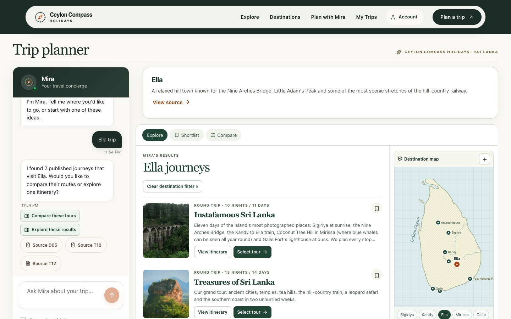

# Mira · Ceylon Compass Holidays

A fictional Sri Lanka travel concierge. Mira turns a conversation into published journeys, an itinerary excerpt, a workbook-verified quote when supported, or a private request for a specialist.

Try **Ella trip** and then **Compare these tours**. Open a tour to inspect its published itinerary, choose a map pin to explore a destination, or bookmark a journey for the current visit. [Screenshot report](docs/Mira-Trip-Planner-Review.pdf) · [Technical verification](docs/UI_REDESIGN_REPORT.md)



## Start

Install Node.js 22+, npm, Python 3.13, `uv`, and `make`. Keep the supplied data folder next to this README. Run this from the workspace root.

```sh
make dev
```

Open [Mira](http://127.0.0.1:3000). The native command installs locked dependencies, starts both services, and prints the source and integration health. FastAPI listens on loopback port 8000. [Health](http://127.0.0.1:8000/api/health) and [OpenAPI](http://127.0.0.1:8000/docs) are available while it runs.

The demo clock defaults to **19 November 2026**, matching the assessment. Try “Sigiriya day trip for two adults on 10 January 2027” or “Design a 10-day custom journey across Kandy and Ella for a family of four.” The booking form uses simulations and accepts no payment information.

Copy `.env.example` to `.env` to configure staff and providers. Generate a different long random value for each staff role with `openssl rand -hex 32` and paste that role’s token into Staff console. Roles and publication are enforced by the API. Gemini suggestions, Gemini draft generation and Langfuse export need their corresponding credentials. With no secrets, the app uses rule-based discovery, extractive drafts and SQLite trace stages.

`docker compose up --build` is included for Docker hosts. The workbook is mounted read-only. Docker was unavailable during host validation. To isolate fixtures or repeat the demo independently, set `MIRA_DB=/absolute/path/to/new-demo.sqlite3` before starting.

## Check

```sh
make lint
make test
make eval
make build
make smoke
make browser
make mcp-smoke
shasum -a 256 -c docs/source-sha256.txt
```

Browser checks require the running app. Install Playwright Chromium using `npm --prefix apps/web exec -- playwright install chromium` or supply the browser executable path with `MIRA_CHROME`. Enable screenshot capture with `MIRA_SCREENSHOTS=1`. The browser staff check runs when local Editor and Approver tokens are available to both processes. Smoke checks assume the assessment clock.

## Evidence and design

- [Desktop quote](docs/screenshots/desktop-quote.png), [mobile home](docs/screenshots/mobile-home.png), [mobile specialist handoff](docs/screenshots/mobile-journey.png)
- [Architecture, component catalogue and ADRs](docs/ARCHITECTURE.md)
- [Workbook rules and four sample comparisons](docs/PRICING_RULES.md)
- [Source inventory, row anomalies and integrity](docs/DATA_AUDIT.md)
- [Observed evaluation report](evals/report/report.md) and [machine-readable report with local trace stages](evals/report/report.json)
- [Reproduced pricing bugs and fixes](docs/BEFORE_AFTER.md)
- [Security and role boundaries](docs/SECURITY.md), [demo outline](docs/DEMO_SCRIPT.md), and [limitations and AI usage](docs/KNOWN_LIMITATIONS.md)

The test suite keeps the historical Q-1043 email expectation visible as a disagreement. The authoritative calculation includes the applicable extra beds and produces **USD 2,965**, deposit **USD 742**. The other three workbook calculations match their sample emails.

For a quote trace, open the verified quote’s corresponding entry in Staff console and expand **Trace**, then **Internal finance**. The guest interface receives a public quote DTO containing only the selling amount, deposit, balance, tour and traveller context.

### Optional live judge

Independently review the ten IDs in `evals/judges/review-set.json`. Create a local JSON array with `id`, `reviewed_on`, `reason` and boolean `grounded`, `relevant`, `helpful` and `non_invented` for each case. With an authorized Gemini configuration, run `PYTHONPATH=apps/api .venv/bin/python evals/judge.py --labels /path/to/review.json`. This sends the selected fictional prompts and source excerpts to the configured provider. The committed report records the absence of an independent human review and live judge run.

### Local MCP bonus

Start Mira with `make dev`. Configure a local MCP client to use command `node` with the absolute path of `apps/web/mcp/server.mjs` as its argument. The server exposes `search_tours`, `get_quote` and `create_enquiry` over stdio. It uses a separate guest session and the same FastAPI catalogue, pricing and enquiry paths as the website. `make mcp-smoke` runs a real MCP client against the local transport.

Keep this assignment and the original dataset in an access-controlled private repository shared only with the authorized reviewer. Keep `.env`, visitor databases and tokens out of Git. See the [file inventory](docs/FILES.md) for generated deliverables.
