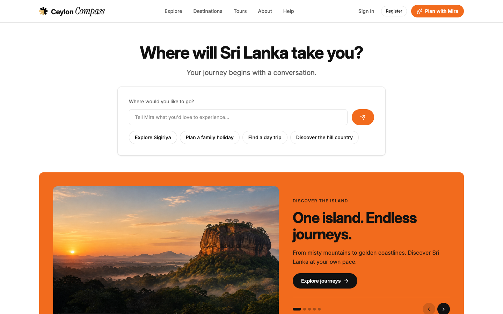

# Mira · Ceylon Compass Holidays

An AI-assisted Sri Lanka travel booking concierge built with **FastAPI**, **LangGraph**, **A2UI**, **SQLite/Alembic**, **React**, and **Next.js**. Mira turns natural-language conversations into grounded tour discovery, itinerary previews, workbook-verified deterministic quotes, or private specialist enquiries.

- **Final Demo Video:** [Watch on YouTube](https://youtu.be/dlM9A4Ij0zg)
- **Submission PDFs:** [Evaluation & Reliability Report](submission/Mira_Evaluation_and_Reliability_Report.pdf) · [Product Experience & Workflow Guide](submission/Mira_Product_Experience_and_Workflow_Guide.pdf)



---

## Quick Start

**Prerequisites:** Node.js 22+, npm, Python 3.13, `uv`, and `make`. Keep `GenAI-Intern-Take-Home-Assignment/ceylon-compass-dataset` at the repository root.

1. **Configure environment:**
   ```sh
   cp .env.example .env
   ```
   Optional: set `GEMINI_API_KEY` for LLM-assisted discovery/drafts, `MIRA_DB=.mira/demo.sqlite3` for an isolated demo database, and `MIRA_ADMIN_EMAIL` / `MIRA_ADMIN_PASSWORD` for admin bootstrap. Without API keys, Mira runs deterministically using local discovery rules and extractive drafts.

2. **Initialize a clean demo database (optional):**
   ```sh
   make demo-db
   ```
   Creates `.mira/demo.sqlite3` at Alembic `head` (`0006_enquiry_contact_fields`) with synthetic demo accounts (`admin`, `approver`, `editor`, `staff`, `traveller`) and zero stray test records.

3. **Start all services:**
   ```sh
   make dev
   ```
   Starts and supervises:
   - **Canonical Travel Workspace (React + Tailwind + A2UI):** `http://127.0.0.1:5175/workspace/index.html`
   - **Staff & Admin Console:** `http://127.0.0.1:5175/staff` (and `http://127.0.0.1:3000/staff`)
   - **Sign In / Register / Profile:** `http://127.0.0.1:5175/login`, `/register`, `/profile`
   - **Editorial Notebook (Next.js):** `http://127.0.0.1:3000`
   - **FastAPI Backend:** `http://127.0.0.1:8000` ([Health](http://127.0.0.1:8000/api/health) · [OpenAPI](http://127.0.0.1:8000/docs))

The evaluation clock defaults to **19 November 2026** (`AS_OF_DATE=2026-11-19`). Try *"Sigiriya day trip for two adults on 10 January 2027"* or *"Design a 10-day custom journey across Kandy and Ella for a family of four."* Payment/booking forms are simulated.

---

## Architecture & Key Features

- **Frontend (`apps/ceylon-compass` & `apps/web`):**
  - `apps/ceylon-compass/workspace/Workspace.jsx` — Interactive Travel Workspace with streaming A2UI surfaces (`TourCard`, `PriceBreakdown`, `EnquiryNotice`, `RouteMap`, `SourcePanel`, `BookingFormPanel`), saved trips, and traveller enquiry tracking.
  - `apps/ceylon-compass/src/components/staff/StaffConsole.tsx` — Unified Staff & Admin Console for enquiry management (status, assignment, notes, follow-up dates), internal finance & trace inspection, deterministic Rate Preview (zero DB writes), draft review/publishing, and user role administration.
- **Backend (`apps/api/mira/`):**
  - **LangGraph Workflow (`agent.py` & `agent_workflow/`):** Modularized stateful orchestration (`interpret` → `retrieve` → `quote` / `compose` → `save`) emitting validated AG-UI / A2UI events.
  - **Deterministic Pricing (`data.py`, `rates_repository.py`, `accommodation.py`):** Server-side `Decimal` pricing from `rate_sheet_2026-27.xlsx` (stored via SHA-256 snapshot in SQLite). Missing or out-of-window rates never invent prices and automatically create specialist enquiries (`ENQ-2026-XXXXXXXX`).
  - **Authentication & RBAC (`auth.py`):** Cookie-backed sessions (`mira_auth` + `mira_session`), Argon2/PBKDF2 password hashing, lockout protection, and strict role boundaries:
    - `traveller`: Manage own trips, quotes, bookings, simulated payments, profile, and enquiries.
    - `staff`: View/manage enquiries, add internal notes, run Rate Preview, and create content drafts.
    - `approver`: Exclusively authorized to review and publish content drafts.
    - `admin`: Manage user roles/status (cannot publish drafts directly).
  - **Persistence (`store.py`, `migrations/`):** SQLite with WAL mode and Alembic migrations `0001_catalogue` through `0008_booking_payments`.

---

## Post-Demo Improvements (Beyond `assignment-submission` `75d40b8`)

> The original take-home submission is preserved unmodified at tag **`assignment-submission`** (`75d40b8`). All enhancements below were implemented post-demo on branch `fix/semantic-recommendation-root-cause` without altering the original dataset or rate workbook.

- **Auth, Ownership & Persistence Hardening (`auth.py`, `persistence.py`):** Unified authenticated user and anonymous visitor ownership checks across reads/writes, preserving trip persistence across same-user session rotations.
- **Modular Agent Workflow & Hybrid Semantic State Machine (`agent_workflow/state_machine.py`, `interpret.py`, `provider.py`):**
  - Typed `TripState` with hierarchical `ItinerarySegment` allocations, 13 scoped operations (`ADD_SEGMENT`, `REMOVE_SEGMENT`, `TRANSFER_DAYS`, `SET_SEGMENT_DURATION`, etc.), and an atomic deterministic reducer enforcing segment conservation and HITL clarification for ambiguous mutations.
  - Compact `_GeminiInterpretation` structured schema for live Gemini coreference resolution and speech-act classification (separating read-only factual/policy questions from state mutations).
  - Pending task continuation (`quotation` and `duration_choice`) so date/party follow-ups resume active tour quotes instead of hijacking into custom planning.
- **Multi-Destination & Scoped Retrieval (`discovery.py`, `retrieve.py`, `compose.py`, `planner.py`):**
  - Multi-destination filtering, partial-match ranking/labeling, zero-match honesty, scoped follow-up filtering (`current_suggestions` / `historical_suggestions`), and product-specific factual QA.
  - Grounded activity filtering in `planner.py` to exclude raw package summaries, route lists, and hotel stay lines from daily activities.
- **Two-Phase HITL Booking Cancellation & My Bookings Dashboard (`cancellation.py`, `main.py`, `Workspace.jsx`):**
  - Published `P02` cancellation policy engine in `Asia/Colombo` timezone with authoritative departure-time checks, specialist escalation near the 48h boundary, and two-phase confirmation (`POST /api/bookings/{ref}/cancel/preview` + `POST /api/bookings/{ref}/cancel`).
  - Simulated balance payment endpoint (`POST /api/bookings/{ref}/pay`) with idempotency keys and `booking_payments` ledger (`0008_booking_payments`).
  - **My Bookings** tab in the traveller profile with live summary metrics, status filters, payment progress, payment history, and HITL cancellation confirmation.

---

## Verification & Checks

Automated tests (`pytest`), deterministic evaluations (`evals/runner.py`), and Playwright browser tests (`make workspace-browser`) always execute against isolated temporary SQLite databases.

```sh
make lint               # Python compileall + TypeScript typechecks (apps/web & apps/ceylon-compass)
make test               # Frontend Vitest + backend pytest suites
make build              # Production builds (Nitro/Vite + Next.js)
make eval               # Test suite + 54 deterministic evaluation cases (53/54, 63/63 UI turns)
make mcp-smoke          # Standalone MCP stdio integration verification (10/10 passed)
make workspace-browser  # Playwright E2E desktop & mobile workflows (9/9 passed)
shasum -a 256 -c docs/source-sha256.txt  # Verify supplied dataset checksums (39/39 OK)
```

Browser checks require Playwright Chromium (`npm --prefix apps/web exec -- playwright install chromium`) or `MIRA_CHROME`.

- **Known Q-1043 Source Disagreement:** Sample email `Q-1043` lists USD 2,680 / deposit USD 670, whereas the authoritative `rate_sheet_2026-27.xlsx` calculation with applicable extra beds produces **USD 2,965** / deposit **USD 742** (`53/54` evals pass; `Q-1043` is intentionally preserved as a documented disagreement).
- **Known Limitations:** Simulated mock booking/payment state (no real payment gateway), local SQLite WAL persistence suited to single-host demo/evaluation, human judge calibration pending independent labels (`evals/report/judge.json` `agreement: null`), remote Langfuse cloud export unverified offline, and MCP verified via `@modelcontextprotocol/sdk` stdio (external desktop GUIs not separately launched).

---

## Logging, Observability & Troubleshooting

`make dev` supervises all three services and labels logs by component (`[WEB]`, `[NEXT]`, `[API]`, `[AGENT]`, `[LLM]`, `[RAG]`, `[PRICING]`, `[TRACE]`, `[ERROR]`):

```sh
LOG_LEVEL=DEBUG make dev
LOG_FORMAT=json make dev
LOG_LLM_DETAILS=true LOG_LEVEL=DEBUG make dev
```

- **Request & Trace Correlation:** Responses include `X-Request-Id` and AG-UI turns include `X-Trace-Id` for trace inspection in the Staff Console.
- **Optional Langfuse Export:** Configure `LANGFUSE_PUBLIC_KEY`, `LANGFUSE_SECRET_KEY`, and `LANGFUSE_BASE_URL` in `.env` for sanitized remote trace export.
- **Port Conflicts:** If startup reports a port in use, inspect and stop the owning process:
  ```sh
  lsof -nP -iTCP:3000 -iTCP:8000 -iTCP:5175 -sTCP:LISTEN
  ```

---

## Documentation & Audit Reports

- **Architecture & Pricing:** [docs/ARCHITECTURE.md](docs/ARCHITECTURE.md) · [docs/PRICING_RULES.md](docs/PRICING_RULES.md) · [docs/SECURITY.md](docs/SECURITY.md) · [docs/KNOWN_LIMITATIONS.md](docs/KNOWN_LIMITATIONS.md)
- **Demo & Integration Guides:** [docs/DEMO_CHECKLIST.md](docs/DEMO_CHECKLIST.md) · [docs/DEMO_SCRIPT.md](docs/DEMO_SCRIPT.md) · [docs/WORKSPACE_INTEGRATION.md](docs/WORKSPACE_INTEGRATION.md)
- **System Audits & Stabilization:**
  - [docs/system-audit/IMPLEMENTATION_REPORT.md](docs/system-audit/IMPLEMENTATION_REPORT.md)
  - [docs/system-audit/ENQUIRY_IDENTITY_AUDIT.md](docs/system-audit/ENQUIRY_IDENTITY_AUDIT.md)
  - [docs/system-audit/CLEAN_DATABASE_RESET.md](docs/system-audit/CLEAN_DATABASE_RESET.md)
  - [docs/system-audit/FINAL_ENVIRONMENT_STABILIZATION.md](docs/system-audit/FINAL_ENVIRONMENT_STABILIZATION.md)
- **Semantic Discovery & Architecture Docs:** [docs/SEMANTIC_DISCOVERY.md](docs/SEMANTIC_DISCOVERY.md) · [REFACTOR_REPORT.md](REFACTOR_REPORT.md)
- **Evaluations & Screenshots:** [evals/report/report.md](evals/report/report.md) · [docs/screenshots/desktop-quote.png](docs/screenshots/desktop-quote.png) · [docs/screenshots/mobile-journey.png](docs/screenshots/mobile-journey.png)
- **Local MCP Server:** `node apps/web/mcp/server.mjs` exposes `search_tours`, `get_quote`, `create_enquiry`, `list_destinations`, `get_tour_details`, and `get_enquiry_status` over stdio. Run `make mcp-smoke` for the standalone isolated verification (`10/10` scenarios). See [docs/MCP_INTEGRATION.md](docs/MCP_INTEGRATION.md).
- **AI Assistance Disclosure:** Codebase analysis, implementation, test authoring, and documentation synthesis were assisted by **Antigravity (Google DeepMind)**, **ChatGPT**, and **Codex**, with all business rules, workbook calculations, security boundaries, and verification evidence validated via executable tests.

> Keep `.env`, SQLite databases, and staff tokens out of version control.
