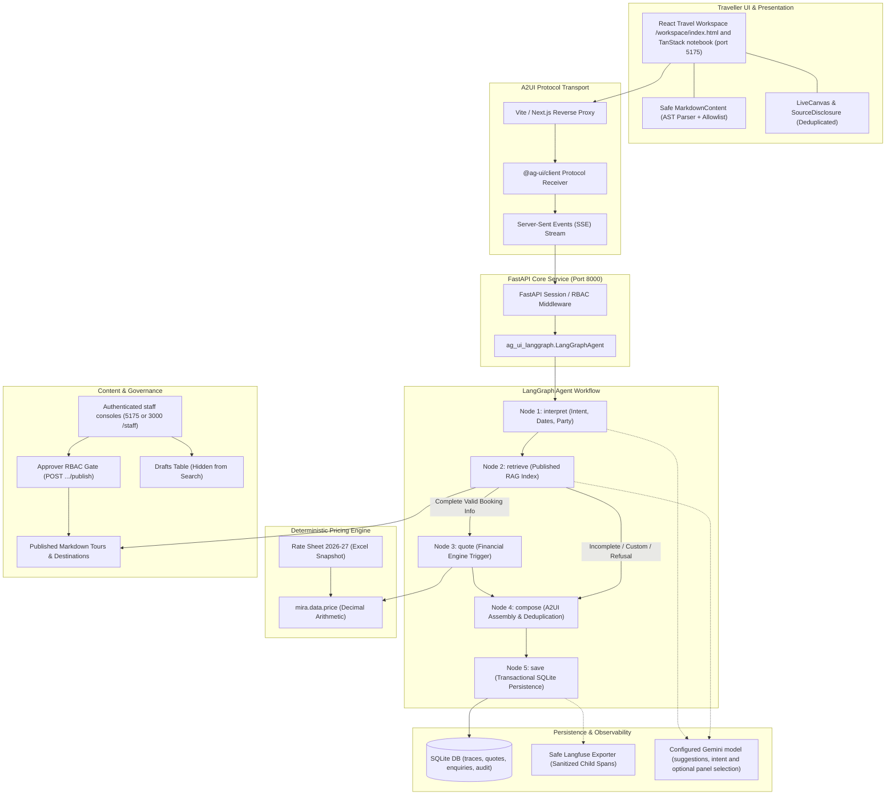

# Architecture and Engineering Design

## System Architecture

The following diagram illustrates the production data flow from traveler interaction through protocol translation, graph orchestration, deterministic financial evaluation, persistent storage, and observability export:

---

## 1. Core Architectural Pillars

### A. LangGraph Agent Orchestration (`apps/api/mira/agent.py`)
The conversational agent is compiled as a typed `StateGraph(GraphState)` executing 5 coordinated nodes:

1. **`interpret`**:
   - Parses incoming traveler prompts, sanitizes input length ($\le 1200$ chars), and recovers multi-turn state from SQLite session context.
   - Deterministically extracts dates (`parse_date`), adult counts, child counts, and individual child ages (`COUNT` regex).
   - In journey planner mode, invokes live Gemini (`notebook_intent`) to parse custom durations and destination stops while constraining outputs strictly to published destination keys.
   - Detects prompt injections (`"ignore instructions"`, `"invent price"`, `"margin"`) and routes them to safe refusals (`action = "reject"`).
2. **`retrieve`**:
   - Queries published markdown documents (`tours`, `destinations`, `policies`).
   - Unpublished drafts, archived promotions (`T14`), and unpublished items (`T15`) are strictly excluded from traveler retrieval.
   - When Gemini is available, `rank()` invokes model ranking with `Suggestions` schema to choose the top 3 published tours matching trip preferences. If unavailable, falls back to local tag overlap.
3. **`quote`**:
   - Evaluated conditionally via edge `quote_route` only when tour, travel date, adult count, and matching child ages are fully specified.
   - Directly executes `mira.data.price()`. The LLM is **never** permitted to compute prices, margins, discounts, or deposits.
   - Missing hotel rates, expired dates, or conflicting tour parameters raise `Unavailable` exceptions, setting structured failure reasons (`missing_amount`, `hotel_rate_missing_or_ambiguous`).
4. **`compose`**:
   - Assembles the customer-facing `Turn` payload using only authorized component models.
   - Attaches verified `PriceBreakdown` and `BookingForm` for successful quotes; attaches `EnquiryNotice` for specialist follow-up on custom/missing rates.
   - Enforces upstream semantic deduplication: suppresses duplicate tour cards and policies across subsequent turns.
5. **`save`**:
   - Executes inside an atomic SQLite transaction (`BEGIN IMMEDIATE`).
   - Persists execution stages to `traces`, public quote DTOs to `quotes`, private specialist follow-ups to `enquiries`, and increments optimistic concurrency revisions.

---

### B. Typed Shared State & Component Catalogue (`apps/api/mira/catalog.py`)

- **State Schema (`GraphState`):**
  - `surface`: Transformed A2UI v0.9 component messages for the streaming protocol.
  - `messages`: LangChain `HumanMessage` / `AIMessage` history.
  - `turn`: Validated Pydantic `Turn` containing `trace: UUID`, `text: str`, `sources: list[str]`, and `components: list[Component]`.
- **Component Catalogue (`Component` union):**
  1. `TourCard`: Card showcasing published tour title, duration, image, and summary.
  2. `TravellerPicker` (`Picker`): Interactive date and party composition selector.
  3. `ItineraryDay` (`Excerpt`): Day-by-day itinerary highlights from published tours.
  4. `PolicySnippet` / `DestinationHighlight` (`Excerpt`): Grounded factual excerpts linked to safe source drawer.
  5. `PriceBreakdown` (`Breakdown`): Displays verified total, deposit, and balance.
  6. `BookingForm` (`Booking`): Interactive simulation of payment decline, network failure, and booking confirmation.
  7. `EnquiryNotice` (`Notice`): Specialist confirmation banner containing unique enquiry reference.
  8. `JourneyPlan` (`Proposal`): Multi-day interactive stopover sequence.
  9. `InteractiveMap` (`RouteMap`): Visual route stop indicator.
  10. `DeparturePicker` (`Departure`): Departure date picker for bespoke routes.
  11. `SourcePanel` (`StayCard`, `ActivityCard`, `ComparisonPanel`, `ConfirmationPanel`, `DestinationCard`, `SourceReference`): Specialized provenance and comparison cards.

All schemas inherit from `Strict(BaseModel)` with `model_config = ConfigDict(extra="forbid")`. Any arbitrary, unapproved, or executable HTML payload is rejected at validation time.

---

### C. Deterministic Financial Pricing Engine (`apps/api/mira/data.py`)

Financial calculations strictly follow the rules documented in `rate_sheet_2026-27.xlsx`:
1. **Fixed Currency Conversion:** Fixed at `LKR 300 = USD 1` through 31 October 2027.
2. **Buy Cost Formula:**
   $$\text{Total Cost} = (\text{Guide/day} \times \text{days}) + (\text{Vehicle/day} \times \text{days}) + \text{Entrances} + (\text{Meals/pax/day} \times \text{days}) + \text{Hotels}$$
3. **Vehicle Tiering:**
   - 1–3 travellers: **Car** (LKR 18,000/day).
   - 4–8 travellers: **Van** (LKR 26,000/day).
   - 9–20 travellers: **Mini coach** (LKR 45,000/day).
   - $> 20$ travellers: Fails closed (`Unavailable("group_size")`).
4. **Rooming & Child Extra Beds (READ ME Rule 4):**
   - 2 adults share a double room. Odd adult takes a single room.
   - Every child aged 2–11 is allocated an extra bed in a parent's room every night.
   - Missing single room rates (e.g. `H04` in `T12`) strictly fail closed (`Unavailable("missing_amount")`).
5. **Commercial Margin & Rounding:**
   - Multi-day tours: $25\%$ margin; Day tours: $30\%$ margin.
   - Selling price formula: $\text{Sell} = \text{Cost} / (\text{FX} \times (1 - \text{margin}))$, rounded **UP to next USD 5**.
   - Multi-day deposit: $25\%$ rounded **UP to whole USD**. Day tours or departures within 30 days require $100\%$ full payment.

---

### D. Content Governance & Human Approval (`apps/api/mira/main.py`)

- **Role-Based Access Control (RBAC):**
  - Roles (`staff`, `editor`, `approver`) are enforced server-side using constant-time bearer token comparisons (`hmac.compare_digest`).
- **Approval Gate:**
  - `POST /api/staff/drafts`: Editors can generate drafts (`status: 'draft'`).
  - Drafts are invisible to traveler searches, catalog listings, and public source endpoints.
  - `POST /api/staff/drafts/{id}/publish`: Strictly restricted to `actor == 'approver'`. Editors receive `403 Forbidden`.
  - Upon approval, the draft status updates to `'published'` and becomes immediately available to the RAG retrieval pipeline.
- **Append-Only Audit Trail:**
  - Database table `audit` records all creation, publication, and follow-up events.
  - SQLite triggers `audit_no_update` and `audit_no_delete` prevent record tampering or deletion.

---

### E. Telemetry, Tracing & Privacy (`apps/api/mira/observability.py`)

- **Correlation:** Every inbound request binds `request_id` (`X-Request-Id`) and `trace_id` (`X-Trace-Id`).
- **SQLite Local Event Store:** Stores execution events per turn (`interpret`, `retrieval`, `pricing`, `validated_ui`, `persistence`).
- **Langfuse Integration (`export_trace`):**
  - Exports root observation `mira.turn` and correlated child stage spans.
  - Applies PII sanitization: redacts email addresses (`[REDACTED_EMAIL]`), strips Bearer tokens, and excludes staff buy costs (`cost_lkr`) and commercial margins from external spans.
  - Telemetry failures fail-closed without corrupting customer quotes or blocking bookings.

---

## 2. Design Decisions and Engineering Trade-Offs

| Decision | Justification | Trade-off Accepted |
|:---|:---|:---|
| **LangGraph for Orchestration** | Provides clear, auditable state graphs, explicit conditional edges, and robust memory checkpointers instead of unpredictable autonomous ReAct loops. | Requires explicit node definition and schema maintenance rather than free-form agent autonomy. |
| **Deterministic Pricing (Zero LLM Arithmetic)** | Financial accuracy is mandatory. LLMs suffer from numerical drift, non-determinism, and hallucinated calculations. Arbitrary-precision Python `Decimal` guarantees exact financial results. | Natural language requests must be mapped to discrete parameters (`adults`, `ages`, `date`) before pricing. |
| **Preserving Original Datasets Unchanged** | Ensures complete auditability against employer goldens and protects source-of-truth integrity. | Rate sheet anomalies (formatting quirks, expired seasons, missing single rooms) must be normalized or failed closed in code. |
| **Separating Internal IDs from UI Presentation** | Exposing internal codes (like `T01`, `H04`) confuses travelers and degrades UI aesthetics. Friendly labels (`"Tour details"`) improve customer UX while retaining IDs internally for provenance. | Requires mapping presentation layers to metadata titles across frontend components. |
| **Safe AST Markdown Rendering** | Prevents XSS vulnerabilities while properly formatting headings, lists, bolding, and links from catalog Markdown. Raw unrendered markdown in expandable disclosures looked unpolished. | Extra client parsing step (using lightweight AST tokenizer and sanitization) instead of plain string dumping. |
| **Upstream Deduplication** | In multi-turn chat, repeating identical tour cards and disclosures across consecutive turns cluttered the right-hand canvas. | Requires state-tracking across turns to filter previously displayed components. |
| **SQLite with WAL Mode for State** | Zero-dependency, single-file ACID transactional database with immediate file locking. Perfect for local evaluation, demos, and reproducibility without configuring external database services. | Multi-instance horizontal scaling would require migrating to PostgreSQL with a distributed checkpointer. |

---

## 3. Honest Disclosure of AI-Assisted Tooling

In accordance with academic and professional integrity standards:
- **Architecture, Code Refactoring & Audits:** Developed with the assistance of Antigravity AI (Google DeepMind), utilized as a collaborative pair-programmer for codebase analysis, test writing, type checking, and documentation synthesis.
- **Core Business Logic:** All financial calculation rules, Excel workbook formulas, database constraints, and deterministic routing paths were derived directly from the employer-provided specification sheets and verified against official evaluation cases.
- **Dataset Preservation:** The original workbook `rate_sheet_2026-27.xlsx`, markdown sources, and evaluation seeds were preserved intact.
