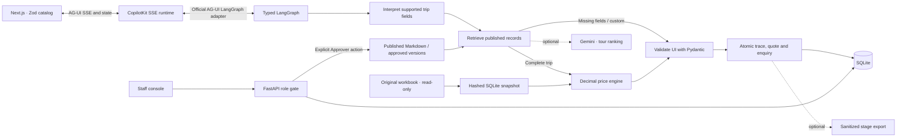

# Architecture

Five LangGraph nodes interpret, retrieve, price, compose and persist. The terminal graph state carries a Pydantic-validated version-1 catalogue. The official Python adapter converts graph events to AG-UI. The CopilotKit Next.js route consumes the stream and relays it through its SSE runtime. The browser uses the official AG-UI client and Zod before rendering.

| UI component | Behaviour |
|---|---|
| TourCard | Open a source or select the published tour |
| TravellerPicker | Submit travel date, adult count and child ages to the graph |
| ItineraryDay | Show a sourced published itinerary excerpt |
| PolicySnippet / DestinationHighlight | Show text evidence and open the safe source viewer |
| PriceBreakdown | Render only the immutable public quote |
| BookingForm | Exercise a deterministic demo booking and retry |
| EnquiryNotice | Display the saved specialist reference |

The streaming integration emits lifecycle, graph step, text message and state events. The browser reads the final validated turn. The smoke test observed 23 AG-UI events for a verified quote. Local deterministic replies arrive as a complete message. Browser actions submit new AG-UI runs or call the booking API. Useful content is kept visible during subsequent discovery. OpenAPI is available at the native FastAPI service's `/docs`.

## Decisions

- Next.js hosts the CopilotKit runtime and the interface in one web service. FastAPI owns all roles, state, quotes and bookings.
- FastAPI constructs a fresh LangGraph checkpointer per run. SQLite owns cross-run session state and atomic saves. Client-supplied graph state, tools and configuration are discarded by the API boundary.
- Use SQLite's standard driver, foreign keys and idempotent schema versioning. The small store and explicit SQL make private and public projections reviewable. A move to SQLAlchemy and Alembic remains future work.
- Use deterministic extraction for monetary intent and source-backed excerpts. Optional Gemini ranking chooses published tour IDs for suggestions. Optional Gemini draft generation cannot publish. Neither model path provides financial inputs.
- A small catalogue is loaded by exact names, aliases, policy topics and destination metadata. Search currently scans this in-memory catalogue plus published studio records. Vector search and incremental FTS indexing are unnecessary for the current source size.
- JSON and server-controlled enums keep HTML and arbitrary actions outside the interface contract. Compass art and destination illustration are original SVG/CSS.
- SDK versions are pinned in the package and Python locks. CopilotKit runtime 1.89.0, AG-UI client 1.0.5, Python adapter 0.0.47, LangGraph 1.2.23, Google Gen AI 3.6.1, Langfuse 5.2.0, Next.js 16.4.6 and FastAPI 0.165.0.

API references. [CopilotKit](https://docs.copilotkit.ai/langgraph-python/quickstart), [AG-UI Python integration](https://github.com/ag-ui-protocol/ag-ui/tree/main/integrations/langgraph/python), [LangGraph](https://docs.langchain.com/oss/python/langgraph/overview), [Gemini structured output](https://aistudio.google.com/docs/structured-output), [Langfuse Python SDK](https://langfuse.com/docs/observability/sdk/overview).
