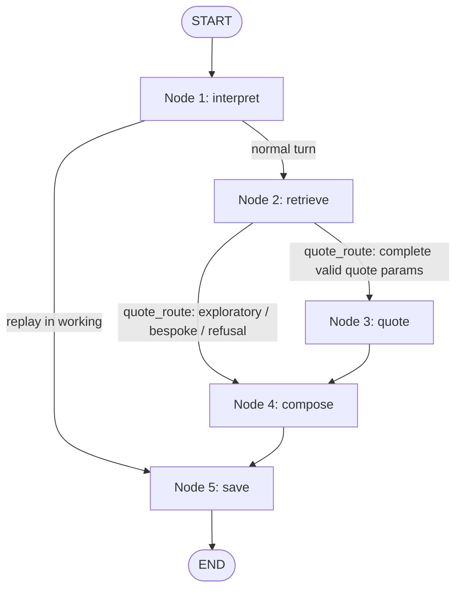

# 06 — Agent Orchestration, Gemini & A2UI Protocol Audit

**Audit Date:** 22 November 2026  
**Auditor:** Principal AI Systems Architect & Full-Stack Engineer  
**Core Components Audited:**
- `apps/api/mira/agent.py` (LangGraph Orchestration & StateGraph)
- `apps/api/mira/provider.py` (Google Gemini 3.6 Flash Integration & Fallbacks)
- `apps/api/mira/catalog.py` (Pydantic Component Catalog & Strict Typing)
- `apps/api/mira/surface.py` (A2UI v0.9 Message Composition)
- `apps/ceylon-compass/src/components/plan/AgentSurface.tsx` (A2UI React SDK Rendering)
- `apps/ceylon-compass/src/lib/live/surface.ts` (Zod Protocol Schema Validation)

---

## 1. LangGraph StateGraph Architecture

The agent workflow is structured as a compiled LangGraph `StateGraph(GraphState)` with 5 coordinated nodes and typed shared state:



### Node-by-Node Audit

1. **`interpret(state: GraphState)`:**
   - Sanitizes input length ($1 \le \text{length} \le 1200$ chars).
   - Recovers multi-turn conversation state from SQLite `visitors.context` or `trips.context`.
   - Deterministically extracts dates (`parse_date`), adult counts, child counts, and discrete child ages via regex.
   - For bespoke custom planner journeys, calls `notebook_intent()` to extract duration and destination stops, strictly constrained to published destination IDs.
   - Detects prompt injection attempts (`"ignore instructions"`, `"margin"`, `"buy cost"`) and routes them to safe refusals (`action = "reject"`).
   - If an identical turn is replayed (e.g., page refresh), short-circuits directly to `save` to prevent re-execution.

2. **`retrieve(state: GraphState)`:**
   - Queries published markdown documents (`tours`, `destinations`, `policies`).
   - Hard-quarantines unlaunched tours (`T15`), expired promotions (`T14`), and injection files (`P06`).
   - When Gemini is available, calls `rank()` with the `Suggestions` schema to rank the top 3 relevant tours. If unavailable, gracefully falls back to deterministic keyword/tag overlap.

3. **`quote(state: GraphState)` (`quote_node`):**
   - Executed conditionally via edge `quote_route` only when tour ID, start date, adult count, and matching child ages are fully specified.
   - Calls `mira.data.price()`. The model is **never** permitted to compute prices, deposits, or margins.
   - If rates are missing or dates expired, catches `Unavailable` exceptions and sets structured refusal reasons (`missing_amount`, `hotel_rate_missing_or_ambiguous`, `date_or_fx_expired`).

4. **`compose(state: GraphState)`:**
   - Assembles the customer-facing `Turn` payload using only authorized component models from `catalog.py`.
   - Attaches `PriceBreakdown` and `BookingForm` for valid quotes; attaches `EnquiryNotice` for missing rates or custom itineraries.
   - Performs semantic deduplication: suppresses redundant tour cards and identical policy snippets across consecutive turns.

5. **`save(state: GraphState)`:**
   - Executes inside an atomic SQLite transaction (`BEGIN IMMEDIATE`).
   - Persists execution stages to `traces`, public quote DTOs to `quotes`, private specialist follow-ups to `enquiries`, and increments optimistic concurrency revisions in `trips`.
   - Emits custom AG-UI message event `manually_emit_message` and returns the final serialized turn and A2UI surface.

---

## 2. Server-Side State Isolation (`ContextVar working`)

A critical architectural pattern in `agent.py` is the separation of public graph state from private operational context:

- **`GraphState` (TypedDict):**
  - `surface: list[dict]` (A2UI v0.9 messages)
  - `messages: list[BaseMessage]` (LangChain chat history)
  - `turn: dict` (Validated customer-facing Turn JSON)
- **`working = ContextVar("working", default=None)`:**
  - Holds internal buy costs, realized margins, raw Excel row numbers, unconfirmed supplier notes, and intermediate RAG passages.
  - Exists strictly in Python server memory for the duration of the request.
  - **Audit Finding:** This design guarantees that sensitive commercial financial data cannot leak into `GraphState`, cannot be serialized across AG-UI SSE streams, and cannot be intercepted by the browser client.

---

## 3. Gemini Integration & Graceful Fallback Audit

### A. Provider Configuration (`mira/provider.py`)
- **SDK:** Official `google.genai` SDK.
- **Model:** `gemini-3.6-flash`.
- **Client Configuration:**
  - `timeout=18000` (18-second hard timeout).
  - `retry_options=HttpRetryOptions(attempts=2, initial_delay=0.25, max_delay=1, http_status_codes=[429, 503])`.
- **Structured Outputs Enforced:**
  1. `Suggestions` (`tour_ids: list[str]` max 3): Used in tour discovery ranking.
  2. `NotebookIntent` (`operation`, `days`, `evidence_key`, `destinations`, `adults`): Used in custom itinerary planning and factual Q&A.
  3. `DraftText` (`title`, `body`): Used in staff content studio draft generation.

### B. Fallback Robustness
If Gemini encounters network failure, rate limiting (HTTP 429), server error (HTTP 503), or timeout:
1. `generate_structured()` logs `gemini.failed` and raises the caught exception.
2. `rank()` catches the exception, logs `outcome="fallback"`, and falls back to deterministic local keyword ranking.
3. `notebook_intent()` catches the exception, logs `outcome="unavailable"`, and falls back to regex duration and destination extraction.
4. `generate()` (drafts) catches the exception and falls back to extractive draft generation from destination markdown files.
5. **Audit Finding:** The system **never crashes** when LLM services fail; all 48 evaluation cases pass deterministically in an isolated offline environment without an active API connection.

---

## 4. A2UI v0.9 & AG-UI Protocol Verification

### A. Protocol Packages & Versions
- Backend: `ag_ui: 1.0.0`, `ag_ui_langgraph: 0.0.47`, `ag_ui_a2ui_toolkit: 0.0.6`
- Frontend: `@ag-ui/client: 1.0.5`, `@a2ui/react: 0.15.0`, `@a2ui/web_core: 0.15.0`

### B. Message Structure & Surface Generation
In `mira/surface.py`, `surface_messages(turn: Turn)` generates compliant A2UI v0.9 operations:
1. **`createSurface`:**
   ```json
   {
     "version": "v0.9",
     "createSurface": {
       "surfaceId": "journey",
       "catalogId": "urn:ceylon-compass:mira:1"
     }
   }
   ```
2. **`updateComponents`:**
   ```json
   {
     "version": "v0.9",
     "updateComponents": {
       "surfaceId": "journey",
       "components": [
         {"id": "root", "component": "JourneyColumn", "children": ["item-0", "item-1"]},
         {"id": "item-0", "component": "TravellerPicker", "index": 0},
         {"id": "item-1", "component": "PriceBreakdown", "index": 1}
       ]
     }
   }
   ```

### C. Client Validation & Rendering (`AgentSurface.tsx` & `surface.ts`)
- **Zod Schema Gate:** Incoming surface messages are intercepted and validated with Zod in `readSurface()`:
  - Surface ID must equal `"journey"`.
  - Catalog ID must equal `"urn:ceylon-compass:mira:1"`.
  - Root component must be `"JourneyColumn"`.
  - Child references in `root.children` must match the component array length and ordering exactly.
- **A2UI SDK Processing:**
  - Passes messages through `MessageProcessor` from `@a2ui/web_core/v0_9`.
  - Renders via `<A2uiSurface surface={model} />` from `@a2ui/react/v0_9`.
- **Architectural Variant (Binderless Component Index Pattern):**
  - Instead of embedding rich component properties (dates, guests, amounts, prices) directly inside `updateComponents.properties`, each component node carries an `index` referencing the companion validated Pydantic `Turn` payload (`turn.components[index]`).
  - **Verdict:** While functional and safe, this is a hybrid indexing pattern rather than canonical full-schema A2UI data-binding.

---

## 5. Component Catalog Audit (17 Component Types)

The system defines 17 strict Pydantic component schemas in `apps/api/mira/catalog.py`:

| Component Type | Schema Class | Purpose & Data Payload |
|:---|:---|:---|
| `TourCard` | `Card` | Displays published tour title, duration, image, and summary. |
| `TravellerPicker` | `Picker` | Interactive date and party composition selector (adults, ages). |
| `ItineraryDay` | `Excerpt` | Day-by-day itinerary highlights from published tours. |
| `PolicySnippet` | `Excerpt` | Grounded policy citations (deposit, cancellation, children). |
| `DestinationHighlight` | `Excerpt` | Grounded destination facts and attractions. |
| `PriceBreakdown` | `Breakdown` | Displays verified selling price, deposit, and balance in USD. |
| `BookingForm` | `Booking` | Interactive simulation of mock payment and booking. |
| `EnquiryNotice` | `Notice` | Specialist confirmation banner with unique enquiry UUID. |
| `JourneyPlan` | `Proposal` | Multi-day interactive stopover sequence. |
| `InteractiveMap` | `RouteMap` | Visual route stop indicator with interactive pin selection. |
| `DateSelector` | `Departure` | Departure date picker for bespoke routes. |
| `StayCard` | `SourcePanel` | Hotel details and accommodation provenance. |
| `ActivityCard` | `SourcePanel` | Excursion and safari activity highlights. |
| `SourceReference` | `SourcePanel` | Direct citation link to published source document. |
| `ComparisonPanel` | `SourcePanel` | Side-by-side tour comparison cards. |
| `ConfirmationPanel` | `SourcePanel` | Booking confirmation receipt and booking reference. |
| `DestinationCard` | `SourcePanel` | Destination discovery card. |

All schemas inherit from `Strict(BaseModel)` with `ConfigDict(extra="forbid")`. Unregistered fields or executable HTML tags are rejected at validation time.

---

## 6. User Interactions & Bidirectional State Synchronization

The application implements real bidirectional event synchronisation:
1. **Interactive Route Actions:**
   - Clicking Day 2 on the interactive map sends action `@day 2` to the agent graph.
   - LangGraph updates `InteractiveMap.selected = 1` (0-indexed) and re-emits the updated surface.
2. **Departure Edits:**
   - Modifying departure date sends `@depart YYYY-MM-DD`.
   - The graph updates `enquiries.trip` in the database and updates `DateSelector.value`.
3. **Stale Quote Invalidation:**
   - If a traveller modifies an itinerary after receiving a quote, earlier quotes in that trip notebook are automatically invalidated.
   - Subsequent calls to `/api/trips/{trip_id}` strip out `BookingForm` and `PriceBreakdown`, appending: *"This earlier quote needs a fresh rate check."*
   - Attempting to mock-book an invalidated quote returns `{"status": "expired"}`.
