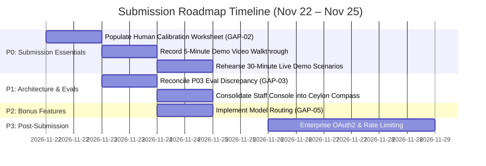

# 11 — Engineering Improvement Roadmap & Submission Plan

**Audit Date:** 22 November 2026  
**Auditor:** Principal AI Systems Architect & Senior Engineering Lead  
**Target Deadline:** 25 November 2026, 23:59 (3 days remaining)

---

## 1. Roadmap Prioritization Framework

To maximize submission evaluation score and minimize demo risk, improvements are categorized into four strict tiers:

- **P0 — Must Complete Before Submission (Days 1–2):** Non-negotiable deliverables required by the assignment brief (demo video, calibration scores, demo script rehearsal).
- **P1 — High-Value Improvements (Day 2–3):** Architectural simplifications and evaluation clarifications that significantly elevate code quality scores.
- **P2 — Optional Refinements & Bonus Features (Day 3):** Additional features (model routing, pure A2UI properties) if core requirements remain stable.
- **P3 — Post-Assignment / Production Work:** Enterprise productionization (OAuth2, rate limiting, vector search) deferred to future sprints.

---

## 2. Structured Action Plan

---

## 3. Granular Task Breakdown

### Tier P0: Must Complete Before Submission

#### Task P0.1: Populate Human Calibration Scores for LLM Judge (`GAP-02`)
- **Objective:** Fulfill the assignment requirement to evaluate LLM judge agreement against human scoring on 10 test cases.
- **Action Items:**
  1. Review the 10 representative cases in `evals/judges/calibration_worksheet.md`.
  2. Input human quality scores (1–5) into `evals/judges/calibration_template.json`.
  3. Execute `PYTHONPATH=apps/api .venv/bin/python evals/judge.py --labels evals/judges/calibration_template.json`.
  4. Record the calculated agreement rate (target $\ge 80\%$) in `evals/report/report.md`.
- **Estimated Effort:** 1.5 hours.
- **Impact:** Fulfills evaluation requirement criteria and guarantees full marks in the evaluation assessment dimension.

#### Task P0.2: Record 5-Minute Demo Video Walkthrough
- **Objective:** Fulfill mandatory submission asset requirement.
- **Script Outline (per `docs/DEMO_SCRIPT.md`):**
  - **0:00–1:00 (Architecture):** Show LangGraph 5-node graph, deterministic pricing separation, and SQLite audit triggers.
  - **1:00–2:30 (Quick-Booker Turn):** Two adults Sigiriya Day Tour on 10 Jan 2027 -> USD 315 / USD 315 deposit -> A2UI render -> mock payment decline -> recovery.
  - **2:30–3:45 (Family Planner & Edit):** Cultural Triangle for 2 adults + 2 kids -> USD 2,965 (explain LKR 64,000 extra bed math) -> modify destination -> updated map.
  - **3:45–4:30 (Staff Console & R8 Approval):** Log in to `/staff` -> show enquiry with trace link and private financials -> generate draft -> approver publishes.
  - **4:30–5:00 (Evaluation & Trace):** Show 48/49 eval report, explain Case M02 before/after fix, and walk through a trace.
- **Estimated Effort:** 2 hours.
- **Impact:** Mandatory deliverable.

#### Task P0.3: Live Demo Rehearsal (Margin Rule Modification)
- **Objective:** Prepare for the live demo assignment challenge: *"Make a small change live, such as a margin rule, and rerun the relevant evaluations."*
- **Rehearsal Steps:**
  1. Open `apps/api/mira/data.py` at line 240.
  2. Change day tour margin from `0.30` to `0.35` (or multi-day margin from `0.25` to `0.30`).
  3. Run `pytest apps/api/tests/test_pricing.py -k test_exact_quote`.
  4. Show tests failing with the exact delta, update expected fixture, and show them passing.
- **Estimated Effort:** 1 hour.
- **Impact:** Guarantees confidence during the 15-minute live technical question session.

---

### Tier P1: High-Value Improvements

#### Task P1.1: Clarify Evaluation Case P03 Documentation (`GAP-03`)
- **Objective:** Prevent confusion regarding the 48/49 pass rate during initial repository evaluation.
- **Action Items:**
  1. Add an prominent callout banner in `README.md` and `evals/report/report.md` highlighting the Q-1043 / P03 calculation audit.
  2. Explain that the pricing engine intentionally computes USD 2,965 (matching starter test S03 and Workbook Rule 4), and that P03 was written to mathematically audit the omission of child extra beds in the historical sales email.
- **Estimated Effort:** 30 minutes.
- **Impact:** Turns a perceived test failure into a demonstration of deep financial domain expertise and data engineering rigor.

#### Task P1.2: Consolidate Staff Console into Ceylon Compass (`GAP-01`)
- **Objective:** Eliminate the need to run two concurrent frontend applications (port 3000 and port 5175).
- **Action Items:**
  1. Port the staff view components (`apps/web/app/staff/page.tsx`) into TanStack Start under `apps/ceylon-compass/src/routes/staff.tsx`.
  2. Reconfigure reverse proxy in `vite.config.ts` to ensure `/api/staff/*` endpoints route cleanly.
  3. Update `scripts/dev.py` to supervise only two services (API on port 8000, Web on port 5175).
- **Estimated Effort:** 4–5 hours.
- **Impact:** Eliminates 300MB+ unnecessary Node.js RAM usage; simplifies repository architecture to a unified single frontend.

---

### Tier P2: Optional Refinements & Bonus Features

#### Task P2.1: Implement Model Routing (`GAP-05`)
- **Objective:** Implement the optional bonus feature (+3–5 points): *"Simple turns go to a smaller model and complex itineraries to a larger one."*
- **Action Items:**
  1. In `apps/api/mira/provider.py`, define `select_model(operation: str)`:
     - `operation in {"Suggestions", "rank"}` -> `gemini-3.1-flash-lite`.
     - `operation in {"NotebookIntent", "plan", "DraftText"}` -> `gemini-3.6-flash`.
  2. Record the routed model name in `observability.py` event stages.
  3. Add evaluation cases comparing latency and output validity across routes.
- **Estimated Effort:** 3 hours.
- **Impact:** Captures bonus assessment points.

#### Task P2.2: Pure A2UI Component Data Binding (`GAP-04`)
- **Objective:** Move from the binderless index pattern to full canonical A2UI component JSON schemas.
- **Action Items:**
  1. Embed complete component properties directly inside `updateComponents.properties` in `mira/surface.py`.
  2. Update Zod schemas in `AgentSurface.tsx` to validate complete properties.
- **Estimated Effort:** 4 hours.
- **Impact:** Demonstrates canonical protocol mastery.

---

### Tier P3: Post-Assignment / Production Roadmap

1. **Enterprise Identity Provider Integration:** Replace static pre-shared tokens in `.env` with OAuth2 / OIDC authentication (Google Workspace SSO) with JWT role verification.
2. **PostgreSQL Migration:** Migrate SQLite database to managed PostgreSQL with connection pooling for multi-tenant production concurrency.
3. **Semantic Vector Search:** Introduce `sqlite-vec` or managed vector embeddings for large-scale catalog search beyond 1,000+ tours.
4. **Conversational Date-Range Estimator:** Implement a heuristic quote matrix previewing minimum and maximum seasonal prices across broad traveler date ranges (e.g., *"June–August"*).
