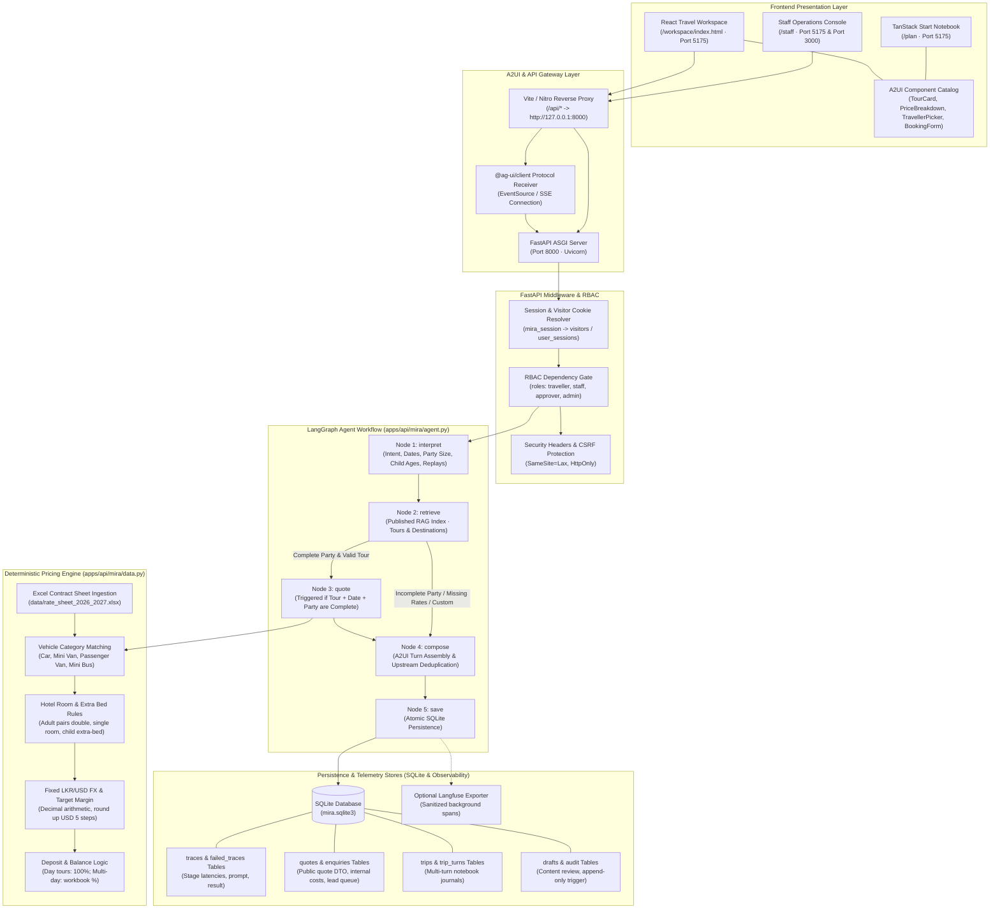
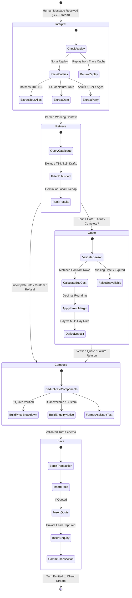
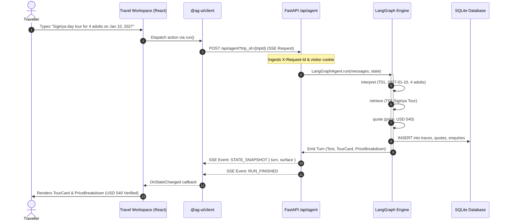
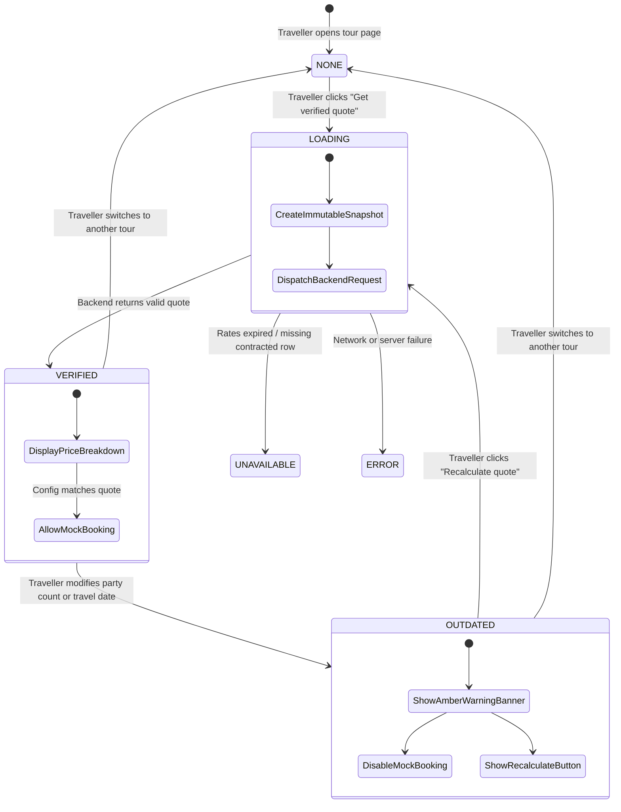
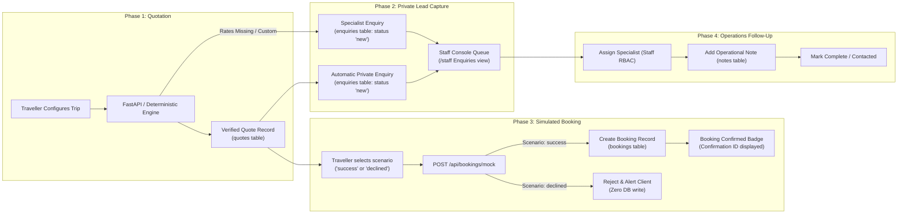
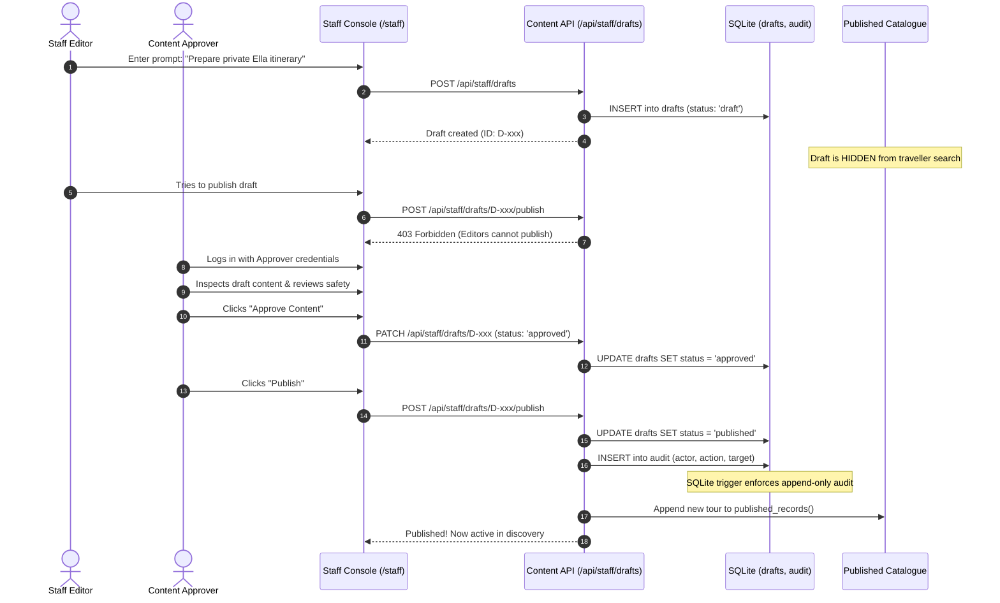

# Technical Architecture & Data Flow: Ceylon Compass Holidays (Mira)

> **Document Purpose:** In-depth architectural blueprint, component catalog, protocol contracts, and end-to-end data flow specifications for the Mira AI Travel Booking Assistant.

---

## 1. Overall System Architecture

The following diagram illustrates the complete runtime architecture, detailing all client boundaries, network transport protocols, backend services, orchestration graphs, and persistence stores:

---

## 2. LangGraph Agent Execution Lifecycle

The conversational agent operates as an explicit, cyclic state machine implemented using `langgraph.graph.StateGraph`:

---

## 3. Traveller Conversation & A2UI Protocol Flow

Communication between the client browser and the FastAPI backend uses the Agent-to-User Interface (A2UI) protocol over Server-Sent Events (SSE):

---

## 4. Verified Quotation Lifecycle

A quotation moves through strict status transitions to guarantee financial correctness and prevent stale prices from being displayed:

---

## 5. Enquiry and Mock Booking Lifecycle

Every commercial interaction is captured for operations staff while preserving simulated test checkout:

---

## 6. Staff Content Approval & Governance Lifecycle

To protect brand integrity, generative AI tour drafting is strictly isolated behind human approval:

