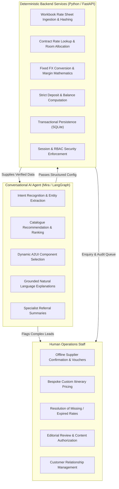

# System Workflow & Business Model Explained: Ceylon Compass Holidays (Mira)

> **Document Purpose:** Complete, beginner-friendly yet technically rigorous guide to the business domain, terminology, user personas, operational boundaries, and end-to-end user journeys in the Mira AI Travel Booking Assistant.

---

## 1. The Business Problem & Value Proposition

### 1.1 What problem does Mira solve?
Bespoke and private holiday planning in Sri Lanka is historically high-friction:
1. **Slow Turnaround:** Independent travellers requesting custom multi-destination itineraries wait 24 to 72 hours for a local travel agent to calculate hotel contracts, vehicle rates, driver allowances, entrance fees, and seasonal markups manually.
2. **The LLM Hallucination Trap:** Pure generative AI chatbots (like standard ChatGPT or Claude wrappers) can fluently describe Sigiriya or Ella, but **consistently hallucinate financial rates**, invent hotel prices, confuse low/peak seasons, apply arbitrary discounts, or fail to account for child extra-bed policies. In tourism, quoting an incorrect price to a client can lead to financial loss or legal liability.
3. **Rigid Booking Engines:** Traditional online travel agencies (OTAs) offer rigid forms that force users into fixed package dates and room options without conversational flexibility.

**Mira bridges this divide:**
Mira acts as a conversational AI travel concierge powered by **LangGraph** and **A2UI (Agent-to-User Interface)**. She converses naturally, extracts traveller intent and preferences, recommends published tours, and structures requests. However, **100% of all pricing calculations are delegated to a deterministic, contract-backed pricing engine** running on immutable rate sheets. When rates cannot be verified, Mira gracefully refers the traveller to human specialists without inventing numbers.

### 1.2 Who are the users?
1. **The Traveller (Guest / Registered Customer):**
   - Discovers Sri Lanka travel destinations, browses curated tours, configures party details (adults, child ages), requests verified quotes, and simulates booking.
   - Accesses conversation history and saved journeys across browser sessions.
2. **The Travel Specialist / Operations Staff:**
   - Monitors incoming private enquiries generated automatically from quotes, custom requests, and missing-rate handoffs.
   - Inspects internal financials (buy cost, profit margins, supplier breakdowns) strictly hidden from travellers.
   - Assigns enquiries, adds operational notes, and manages client follow-ups.
3. **The Content Editor & Approver:**
   - Content Editors prepare draft itineraries and destination guides using generative AI prompts grounded in published knowledge.
   - Approvers review drafts against brand and quality standards before authorizing them to enter the active RAG index.
4. **The Platform Auditor / Administrator:**
   - Reviews system observability, inspects LangGraph turn execution traces, and validates pricing engine accuracy via automated evals.

### 1.3 What does the travel company gain?
- **Zero Hallucination Risk:** Complete protection of margins and pricing integrity.
- **Immediate Lead Capture:** Every quote calculation and custom inquiry is automatically captured as a structured private enquiry in SQLite, eliminating dropped leads.
- **Lower Customer Acquisition Cost:** Travellers receive instant, verified pricing on standard tours and immediate acknowledgement on custom journeys.
- **Content Governance:** Staff can rapidly create new itineraries while maintaining an immutable audit log of who approved what.

---

## 2. Separation of Responsibilities

---

## 3. Core Terminology & Concept Definitions

| Term | Domain Meaning | Application Implementation & Example |
|:---|:---|:---|
| **Tour** | A standardized, published travel package. | Defined in markdown front-matter (e.g. `T01: Sigiriya and Minneriya Day Tour from Kandy`). Has fixed inclusions, itinerary days, and contracted rate lines. |
| **Itinerary** | The chronological sequence of locations, activities, and hotel stays. | Emitted as A2UI `Itinerary` components or parsed custom day tabs (e.g., Day 1 Kandy $\to$ Sigiriya Fortress, Day 2 Minneriya Safari). |
| **Traveller Configuration** | The exact parameters defining the travelling party and timing. | Immutable dictionary: `{ tourId: 'T01', travelDate: '2027-01-10', adults: 4, childAges: [], infants: 0 }`. |
| **Quote** | A financial computation snapshot for an exact configuration. | A JSON entity containing selling total, deposit, balance, currency (`USD`), validity timestamp, and input hash. |
| **Verified Quote** | A quote computed strictly from active contracted rate sheets with no missing parameters. | Accompanied by A2UI `PriceBreakdown` with verified badge, breakdown table, and deposit instructions. E.g., T01 for 2 adults = USD 315; 4 adults = USD 540. |
| **Deposit** | Upfront commitment required from the traveller. | Day tours & departures $\le$ 30 days require 100% upfront. Multi-day tours require the workbook deposit % (e.g. 20–25%), rounded up to the nearest whole USD. |
| **Balance** | Remaining amount payable prior to commencement. | $\text{Balance} = \text{Total} - \text{Deposit}$. For day tours, balance is USD 0. |
| **Enquiry** | A private sales lead stored in the backend database. | Recorded in `enquiries` table with status `new`, linking to `traces` and `quotes`. Created automatically whenever a quote is generated, rates are missing, or a custom journey is requested. |
| **Reservation** | A temporary allocation of seats or accommodation. | In this project, reservations are conceptual and represented by verified quotes held in session state. |
| **Booking** | A confirmed purchase commitment. | **Simulated/Mocked:** Triggered via `POST /api/bookings/mock`. Links a valid quote ID to a new `bookings` record. No real credit card charge occurs. |
| **Mock Payment** | Gateway simulation for testing checkout outcomes. | Allows selecting scenarios: `success` (status: `confirmed`), `declined`, `unavailable`, or `network`. Accepts zero cardholder PII. |
| **Agent** | The multi-node LangGraph workflow. | Executes `interpret` $\to$ `retrieve` $\to$ `quote` $\to$ `compose` $\to$ `save` in `apps/api/mira/agent.py`. |
| **A2UI** | Agent-to-User Interface protocol. | SSE-streamed JSON payloads representing typed React UI components (`TourCard`, `PriceBreakdown`, `Notice`, `Suggestions`). |
| **Trace** | The persistent observability record of an execution turn. | Stored in `traces` table with UUID, duration, stage latencies, source IDs, and optional Langfuse sync. |
| **Evaluation** | The automated regression benchmark. | Executed via `evals/runner.py`. Evaluates 54 cases across 63 turns with deterministic assertion of exact prices and safety. |
| **Content Draft** | An unapproved itinerary or tour document. | Stored in `drafts` table with `status = 'draft'`. Excluded from RAG retrieval until authorized. |
| **Approver** | Staff role with publication authorization. | Role-gated by RBAC (`role == 'approver'`). Only an Approver can execute `POST /api/staff/drafts/{id}/publish`. |

### Crucial Distinction: What is Real vs. What is Simulated?
- **Real Database Operations:** 
  - Creation and retrieval of visitors (`visitors`), sessions (`user_sessions`), trips (`trips`), execution traces (`traces`), calculated quote records (`quotes`), customer enquiries (`enquiries`), internal notes (`notes`), content drafts (`drafts`), and immutable audit logs (`audit`).
  - Parsing and evaluation of contracted rates from the Excel workbook (`data/`).
- **Simulated Operations:**
  - Payment gateway transactions (no Stripe, PayPal, or card tokens exist; checkout uses mock scenarios).
  - External supplier booking confirmations (no live GDS, airline API, or hotel PMS webhooks).

---

## 4. End-to-End User Journeys

### Scenario A: Quick Booking (Verified Day Tour)
**Traveller Prompt:** *"I want a Sigiriya day tour for four adults on January 10, 2027."*

1. **Submission:**
   - Traveller types the message in the A2UI input or clicks "Check rates" after adjusting the traveller picker.
   - Frontend dispatches `POST /api/agent?trip_id={tripId}` with a typed JSON payload or natural language string.
2. **FastAPI Ingestion (`apps/api/mira/main.py: agui`):**
   - Validates message length ($\le 1200$ chars) and extracts visitor cookie `mira_session`.
   - Resolves or creates a trip record in SQLite (`trips`).
   - Instantiates `LangGraphAgent` with `EventEncoder` streaming SSE.
3. **LangGraph Execution (`apps/api/mira/agent.py`):**
   - **`interpret`:** Uses entity regex to extract tour alias (`T01`), date (`2027-01-10`), adult count (`4`), and child ages (`[]`). Formats internal working context.
   - **`retrieve`:** Fetches published tour card for `T01` from `published_records()`.
   - **`quote`:** Conditional edge triggers because tour, date, and party are complete. Calls `mira.data.price()`.
4. **Deterministic Calculation (`apps/api/mira/data.py`):**
   - Reads 2026–2027 rate snapshot.
   - Matches vehicle for 4 adults: Passenger Van (contract cost: LKR 38,000 / day).
   - Guide cost: LKR 8,000 / day.
   - Entrance fees for Sigiriya & Minneriya: $4 \times \text{LKR } 15,000 = \text{LKR } 60,000$.
   - Lunch: $4 \times \text{LKR } 2,500 = \text{LKR } 10,000$.
   - Total LKR Buy Cost = LKR 116,000.
   - Applies fixed FX (300 LKR/USD) and target sales margin (28.4%):
     $$\text{Sale USD} = \left\lceil \frac{116,000}{300 \times (1 - 0.284)} \right\rceil_{5} = \text{USD } 540$$
   - Deposit rule: Day tour $\implies$ 100% deposit = USD 540 (Balance: USD 0).
5. **A2UI Assembly & Persistence (`compose` & `save`):**
   - Emits a `PriceBreakdown` component containing USD 540 total and itemized public inclusions.
   - Transactionally saves public quote in `quotes` and auto-records private enquiry in `enquiries`.
6. **Frontend Display (`apps/ceylon-compass/workspace/Workspace.jsx`):**
   - Renders `PriceBreakdownPanel` with "Verified Quote" badge.
   - Shows party details: "4 adults · Jan 10, 2027".
   - Displays "Mock Booking" options (`success`, `declined`).
7. **Mock Booking Execution:**
   - Clicking "Book Now (Success)" calls `POST /api/bookings/mock` with quote UUID.
   - Backend verifies quote is current, creates record in `bookings`, and returns confirmation ID.
   - Staff console immediately displays the enquiry as associated with a verified booking.

---

### Scenario B: Custom Multi-Day Trip
**Traveller Prompt:** *"We're a family of four and want ten days across Kandy, Ella, and the southern coast."*

1. **Intent Extraction:**
   - `interpret` detects custom keywords: "10 days", locations ("kandy", "ella"), party of four.
   - Recognizes that no single published catalog package covers this exact custom specification.
2. **Catalog Recommendations & Custom Plan:**
   - `retrieve` fetches closest matching tours (`T09` Cultural Triangle, `T10` Hill Country & Coast).
   - Generates an interactive multi-day proposal with destination tabs.
3. **Rates Unavailable Handling:**
   - Because hotels and bespoke transport routes are not pre-contracted as a bundle, the pricing engine refuses to guess amounts.
   - `quote` raises `Unavailable("custom_itinerary")`.
4. **Specialist Referral & Enquiry Capture:**
   - `compose` generates an `EnquiryNotice` component: *"A travel specialist will formulate a custom quote for your 10-day itinerary across Kandy and Ella."*
   - Backend records an enquiry with reason `"custom_itinerary"` in `enquiries`.
5. **Staff Action:**
   - Specialist logs in at `/staff`, opens the enquiry, reviews traveller requested stops and party size, and drafts an offline proposal.

---

### Scenario C: Rates Unavailable / Missing Rates
**Traveller Prompt:** *"Sigiriya day tour for two adults on January 10, 2029."* (or tour `T08` with uncontracted hotel rows)

1. **Validation Failure:**
   - `mira.data.price()` checks date validity against rate sheet: date `2029-01-10` is beyond FX and contract validity (`2027-10-31`).
   - Raises `Unavailable("rate_expired_or_future")`.
2. **Strict Guardrail:**
   - The LLM is prohibited from proposing an estimated price.
   - The quote component is omitted from graph output.
3. **Graceful Degradation:**
   - Agent outputs a friendly notice: *"Contract rates are not yet published for 2029. We've logged an enquiry for our reservations desk to lock in rates when tariffs release."*
   - An enquiry is saved with reason `"rates_unavailable"`.

---

### Scenario D: Failed Mock Booking / Payment
**Workflow:**
1. Traveller generates a verified quote for `T01` (USD 315).
2. Traveller selects `"declined"` or `"network"` in the Mock Booking scenario dropdown and clicks "Try mock booking".
3. Frontend sends `POST /api/bookings/mock` with `{ quote: quoteId, scenario: "declined" }`.
4. Backend handles simulation:
   - Does NOT create a row in `bookings`.
   - Logs an audit event `mock_booking_declined`.
   - Returns `{ "status": "declined", "message": "Card authorization declined by issuer" }`.
5. Frontend displays an accessible amber/red alert: *"Booking declined: Card authorization declined by issuer. Please try another payment method or contact your bank."*
6. Recovery: Traveller selects `"success"` and retries; booking completes cleanly with confirmation.

---

### Scenario E: Staff Content Publication
**Workflow:**
1. **Draft Creation:**
   - An authenticated staff member with role `editor` visits `/staff` $\to$ Content Review.
   - Enters a prompt: *"Prepare a private itinerary using published Ella material."*
   - Backend extracts published paragraphs, structures a draft, and saves it in `drafts` with `status = 'draft'`.
   - Public RAG search (`GET /api/sources`) returns 404 for this draft ID.
2. **Approval Gate:**
   - An editor does not have permission to publish (`POST .../publish` returns 403 Forbidden).
   - An authorized user with role `approver` logs in, inspects the draft text, and clicks "Approve Content".
   - Draft status updates to `'approved'`.
3. **Publication:**
   - Approver clicks "Publish".
   - Backend updates status to `'published'`, records an immutable row in `audit`, and injects the tour into `published_records()`.
   - The new tour immediately becomes discoverable by travellers chatting with Mira.
