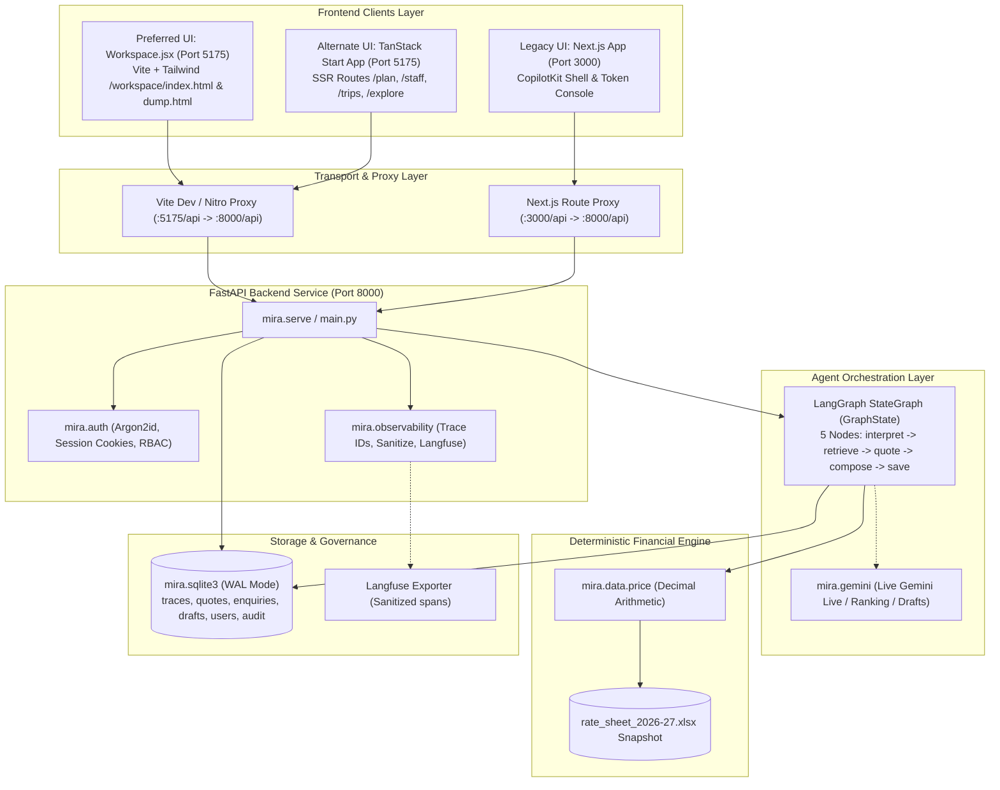
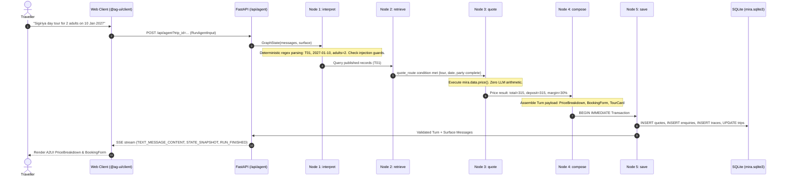

# Architecture and System Integration Audit

**Date:** 25 November 2026  
**Auditor Roles:** Principal Software Architect, Senior Full-Stack Engineer  
**Component:** Full-Stack Architecture, Data Flow, Protocol Mapping

---

## 1. System Topology Overview

The application comprises three distinct process groups supervised by `scripts/dev.py` and `scripts/dev.sh`:

---

## 2. Real Execution Paths vs Duplicated Implementations

An exhaustive scan reveals that the codebase contains **three concurrent frontend presentations** and multiple overlapping service layers.

### 2.1 The Three Frontend Entry Points

1. **`apps/ceylon-compass/workspace/` (The Preferred Travel Workspace):**
   - **Entry Point:** `apps/ceylon-compass/workspace/index.html` mounting `Workspace.jsx`.
   - **Build Target:** Compiled by `workspace/vite.config.mjs` into `apps/ceylon-compass/public/workspace/` (`index.html`, `assets/index-*.js`, `assets/index-*.css`).
   - **Served Aliases:** Served at `http://127.0.0.1:5175/workspace/index.html`, `http://127.0.0.1:5175/dump.html`, and symlinked or copied at workspace root `dump.html`.
   - **Internal State & Router:** Implements its own hash/path router (`useRouter`) with internal pages (`HomePage`, `ExplorePage`, `ToursPage`, `TourDetailPage`, `DestinationsPage`, `DestinationDetailPage`, `MiraWorkspace`, `AboutPage`, `PoliciesPage`, `EnquiryPage`, `LoginPage`, `RegisterPage`, `ProfilePage`, `StaffPage`).
   - **A2UI Implementation:** Renders a 2-column workspace (`Conversation` on left, `Travel Workspace` on right). Listens to `@ag-ui/client` SSE stream through `useConversation.js`.
   - **Status:** **ACTIVE & AUTHORITATIVE**. This is the UI evaluated in `README.md` and user instructions.

2. **`apps/ceylon-compass/src/routes/` (The TanStack Start SSR App):**
   - **Entry Point:** `apps/ceylon-compass/src/router.tsx` and `routeTree.gen.ts`.
   - **Served Routes:** Root path `/`, `/plan`, `/staff`, `/trips`, `/explore`, `/login`, etc.
   - **Key Components:** `LiveCanvas.tsx`, `AgentSurface.tsx` (using `@a2ui/react/v0_9`), `RouteMap.tsx`, `MarkdownContent.tsx`, and `routes/staff.tsx`.
   - **Disconnection:** While `routes/staff.tsx` is an extremely comprehensive 1,018-line implementation with full dashboard, enquiry editing, financial disclosures, trace inspector, draft review, and user management, it is **only accessible if the browser navigates directly to `/staff` in the TanStack Start shell**. When a user is inside the Preferred Workspace (`dump.html`), clicking "Staff" routes to `Workspace.jsx`'s internal `StaffPage` instead!

3. **`apps/web/` (The Next.js App on Port 3000):**
   - **Entry Point:** Next.js 15 app router on `http://127.0.0.1:3000`.
   - **Routes:** `/` (editorial journal), `/plan` (CopilotKit chat shell), `/staff` (legacy 181-line token console), `/api/copilotkit/[[...rest]]`.
   - **Status:** **LEGACY PROTOTYPE**. Retained for backward compatibility with CopilotKit and starter smoke tests.

---

## 3. Backend API Service Layer Map (`apps/api/mira/`)

The FastAPI application (`mira.main:app`) exposes 31 documented endpoints organized into 6 functional domains:

| Domain | Method & Endpoint | Auth Required | Downstream Modules | Functionality |
|---|---|---|---|---|
| **System** | `GET /api/health` | Public | `rates_repository` | Reports rates readiness, published records count, provider status |
| **Catalog** | `GET /api/tours` `GET /api/guide` `GET /api/sources/{key}` | Public | `data.published()`, `store.published_records()` | Returns published tours, destinations, itinerary days, policies. Strictly filters out drafts (`status != 'published'`) and historic (`T14`). |
| **Visitor Session** | `POST /api/session` `GET /api/session` `DELETE /api/session` | Public / Cookie | `store.db()`, `auth.COOKIE` | Manages 30-day consent, session UUIDs, binds authenticated user IDs, clears cookies. |
| **Trips & Journeys** | `POST /api/trips` `GET /api/trips` `GET /api/trips/{trip_id}` | Visitor Cookie | `store.db()`, `surface_messages` | Journey state persistence, multi-turn history retrieval, revalidates saved quotes against current rates. |
| **Agent / Turn** | `POST /api/agent?trip_id={id}` | Visitor Cookie | `agent.graph` (`ag_ui_langgraph`) | **AG-UI Streaming Protocol**. Executes LangGraph 5-node workflow via SSE. Delivers state snapshots, validated A2UI turns, and trace IDs. |
| **Public Quotes** | `GET /api/quotes` | Visitor Cookie | `data.price()`, `rates_repository` | Retrieves session's quotes with `current: true/false` validity flag. Emits `PublicQuote` only (never costs or margins). |
| **Mock Booking** | `POST /api/bookings/mock` | Visitor Cookie | `store.db()` | Simulates checkout outcomes (`success`, `declined`, `unavailable`, `network`, `expired`). |
| **Auth & Profile** | `POST /api/auth/register` `POST /api/auth/login` `POST /api/auth/logout` `GET /api/auth/me` `PATCH /api/auth/profile` `POST /api/auth/password` | Mixed | `auth.py`, Argon2id, `user_sessions` | Account registration, secure password hashing, HttpOnly session cookie creation, lockout checks, profile updates. |
| **Staff Enquiries** | `GET /api/staff/dashboard/overview` `GET /api/staff/enquiries` `GET /api/staff/enquiries/{key}` `PATCH /api/staff/enquiries/{key}` | Role: Staff/Admin | `store.db()`, `auth.role` | Staff dashboard counts, enquiry listing/filtering, enquiry details with internal costs & gross profit %, follow-up status, staff notes, staff assignment. |
| **Content Studio** | `POST /api/staff/drafts` `GET /api/staff/drafts` `POST /api/staff/drafts/{key}/review` `POST /api/staff/drafts/{key}/publish` | Role: Staff/Approver | `gemini.py`, `data.public_text` | Draft generation from destination material, draft listing, review notes, Approver-only publication gate. |
| **Audit & Traces** | `GET /api/staff/traces/{trace}` `GET /api/staff/evaluation` `GET /api/staff/audit` `GET /api/admin/audit` | Role: Staff/Admin | `observability.py`, SQLite `traces` | Full stage execution inspection, deterministic evaluation JSON report, append-only immutable audit trail. |
| **Admin Users** | `GET /api/admin/users` `PATCH /api/admin/users/{user_id}` | Role: Admin | `auth.py`, `store.db()` | User listing with role/status filters, role promotion (`staff`, `approver`, `admin`), account deactivation. |

---

## 4. LangGraph Agent Internal Architecture

The conversation flow is strictly governed by `apps/api/mira/agent.py`:

### Typed Shared State & Catalog Schema
- **State Schema:** `GraphState(TypedDict)` containing `surface: list[dict]`, `messages: list`, `turn: dict`.
- **Catalogue Schemas (`apps/api/mira/catalog.py`):**
  - Inherits from `pydantic.BaseModel` with `extra="forbid"`.
  - Component models: `TourCard`, `TravellerPicker`, `ItineraryDay`, `PolicySnippet`, `DestinationHighlight`, `PriceBreakdown`, `BookingForm`, `EnquiryNotice`, `JourneyPlan`, `InteractiveMap`, `DateSelector`, `SourcePanel`.
- **Validation:** Every turn emitted from LangGraph passes through `Turn.model_validate()`. Malformed or unapproved payloads are stopped before reaching the client.

---

## 5. Security & Isolation Architecture

1. **Deterministic Isolation:**
   - LLMs are completely excluded from pricing calculations, database modifications, and publication decisions.
   - Even when live Gemini is configured, it is restricted to natural language intent assistance (`notebook_intent`), recommendation ranking (`rank`), and content drafting (`DraftText`).
2. **Database Integrity:**
   - Single-file SQLite database with Write-Ahead Logging (`PRAGMA journal_mode=WAL`).
   - Append-only audit logging: Database triggers `audit_no_update` and `audit_no_delete` abort any SQL `UPDATE` or `DELETE` statements on the `audit` table.
3. **Data Protection & PII Redaction:**
   - Outbound telemetry via Langfuse (`export_trace`) strips emails (`[REDACTED_EMAIL]`), auth tokens, staff costs (`cost_lkr`), and commercial margins.
   - Guest APIs (`/api/quotes`, `/api/enquiries/{ref}`) omit internal costs and gross margins.
