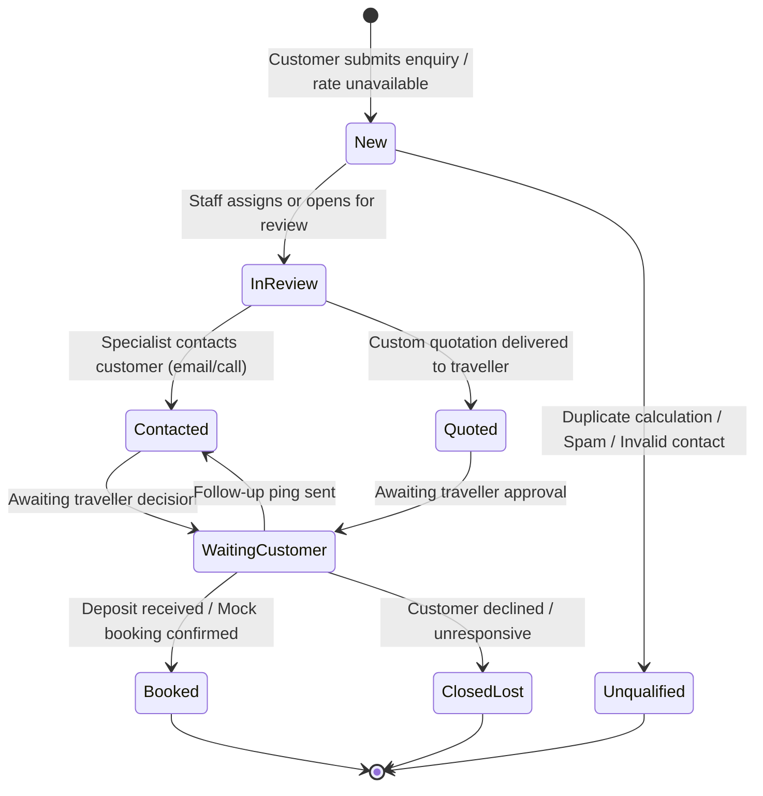

# Deep Audit of Staff Enquiry Management and Customer Follow-Up Workflow

**Project:** Ceylon Compass Holidays — Mira AI Travel Booking Assistant  
**Document ID:** `docs/system-audit/STAFF_ENQUIRY_DEEP_AUDIT.md`  
**Date:** November 25, 2026  
**Auditor:** Senior Full-Stack Engineer, SaaS Product Architect & CRM Workflow Auditor  
**Status:** Audit Complete — Ready for Review (No application code modified)

---

## Executive Summary

A comprehensive investigation into the Ceylon Compass Holidays enquiry architecture, database records, API contracts, and user interfaces was conducted. The investigation explains why the Staff Dashboard currently displays **100 open enquiries**, why all traveller names display as **"Visitor"**, why technical error codes (e.g. `hotel_rate_missing_or_ambiguous`) appear in place of tour titles, and why staff cannot perform meaningful customer follow-up today.

### Core Discoveries

1. **The "100 Enquiries" Mystery:**
   - The primary SQLite database (`.mira/mira.sqlite3`) currently contains **185 total enquiry records**, all created automatically between November 19 and November 24, 2026.
   - The backend API (`GET /api/staff/enquiries`) has a hardcoded clause: `ORDER BY rowid DESC LIMIT 100`. The frontend computes `rows.length`, which naturally equals exactly 100.
   - **Root Cause of Accumulation:** In `apps/api/mira/agent.py` line 831, **every turn that produces a quote or specialist notice automatically inserts a new row into `enquiries`** (`if q or w.get("reason"): conn.execute("INSERT INTO enquiries ...")`). Ordinary browsing, price checks, rate recalculations, and automated evaluation cases immediately generate persistent database enquiries.
   - **Zero Deduping:** Each rate check generates a new UUID. In the development database, an interactive test session of tour `T09` generated **7 separate enquiry rows within a 3-minute span** for the same visitor simply because travellers/guests adjusted passenger counts.

2. **The "Visitor" Identity Void:**
   - The `enquiries` database table contains no customer contact columns (`name`, `email`, `phone` do not exist on the table).
   - Although logged-in visitors have identity stored in the `users` table via `visitors.user_id`, the staff query `SELECT * FROM enquiries WHERE 1=1` does not join `traces`, `visitors`, or `users`.
   - The frontend template in `Workspace.jsx` references `row.name || 'Visitor'`. Because `row.name` is never returned by the API, every record displays as "Visitor".
   - For anonymous guests (non-logged-in), contact information is **never collected**. Anonymous rate calculations and genuine sales leads are completely conflated in the database.

3. **Disjointed Frontend Implementations:**
   - **`Workspace.jsx` (`dump.html` / Travel Workspace):** The staff view is a rudimentary 4-column read-only table. Table rows are completely unclickable, there are no filters, no search, no detail drawers, and no actions to update status, add notes, or assign staff.
   - **`apps/ceylon-compass/src/routes/staff.tsx` (TanStack App):** Contains a richer feature set (status filters, note creation, staff assignment, finance viewing), but displays raw JSON strings (e.g., `{"custom":{...}}`) as the enquiry title and heading, has no customer contact details, lacks follow-up due dates, and is limited to 100 records with no pagination.

---

## 1. Current Enquiry Architecture

The diagram below illustrates how enquiries are currently generated, stored, and retrieved:

```
[Traveller / Visitor]
       │
       ▼
[Mira Conversational Agent / Planner]
  (agent.py: persist())
       │
       ├─────────────────────────────────────────────────────────────────┐
       │ Evaluates quote or specialist condition                        │
       │ (if q or w.get("reason"))                                       │
       ▼                                                                 ▼
[traces Table]                                                  [quotes Table]
  - id (UUID)                                                     - id (UUID)
  - visitor (Token)                                               - trace (FK)
  - events (JSON array)                                           - public (JSON)
  - result (JSON)                                                 - internal (JSON)
       │                                                                 │
       └───────────────────────────────┬─────────────────────────────────┘
                                       ▼
                              [enquiries Table]
                                - id (UUID)
                                - trace (FK to traces.id)
                                - quote (FK to quotes.id, optional)
                                - trip (JSON context string)
                                - reason (String code)
                                - status (Default 'new')
                                - created (UTC Timestamp)
                                - assigned_to (FK to users.id)
                                - assigned_name (String)
                                - updated_at (UTC Timestamp)
                                       │
                                       ▼
                       [Staff API: /api/staff/enquiries]
                         - Query: SELECT * FROM enquiries LIMIT 100
                         - No user join, no quote join, no pagination
                                       │
                                       ▼
                           [Staff Dashboard Frontends]
                             - Workspace.jsx: Static 4-col table
                             - staff.tsx: Raw JSON rendered in titles
```

### Key Architectural Limitations

1. **Unintentional Generation:** Enquiries are treated as a byproduct of agent turn persistence rather than an intentional customer conversion act.
2. **Denormalization Deficit:** High-level summary fields required for CRM listing (tour title, travel date, guests, price, customer name) are buried inside serialized JSON strings (`enquiries.trip`, `quotes.public`, `quotes.internal`).
3. **No Separation of Anonymous Leads vs. Contactable Sales Inquiries:** When an anonymous visitor tests a 2029 date where rates are unavailable, a record is created. Staff cannot follow up because there is no channel of communication.

---

## 2. Actual Data Model & API Endpoints

### 2.1 Database Tables (`.mira/mira.sqlite3`)

#### `enquiries` Table
| Column | Type | Nullable | Description / Current State |
| :--- | :--- | :--- | :--- |
| `id` | `TEXT` | `NO` (PK) | 36-character UUID string (e.g. `1d9db81c-e1b9-4bdf-be0c-7e721a9781fb`). |
| `trace` | `TEXT` | `NO` (FK) | Unique FK to `traces.id`. Ties enquiry to a single agent turn. |
| `quote` | `TEXT` | `YES` (FK) | FK to `quotes.id`. Populated for `verified_quote`, `NULL` for specialist flags. |
| `trip` | `TEXT` | `NO` | Raw JSON string containing trip context (e.g., `{"tour":"T09","date":"2027-01-10"}`). |
| `reason` | `TEXT` | `NO` | Technical error or intent code (`verified_quote`, `hotel_rate_missing_or_ambiguous`, etc.). |
| `status` | `TEXT` | `NO` | Current lifecycle state. Defaults to `'new'`. Check constraint: None in SQLite. |
| `created` | `TEXT` | `YES` | UTC timestamp string generated by `DEFAULT CURRENT_TIMESTAMP`. |
| `assigned_to` | `TEXT` | `YES` (FK) | User UUID of the assigned staff member (`users.id`). |
| `assigned_name`| `TEXT` | `YES` | Full name of the assigned staff member cached at assignment time. |
| `updated_at` | `TEXT` | `YES` | Timestamp of the last status/assignment/note update. |

#### Related Tables
- **`notes` (`id`, `enquiry`, `actor`, `body`, `created`)**: Child table storing internal staff notes per enquiry.
- **`traces` (`id`, `visitor`, `run`, `events`, `result`, `created`)**: Stores event logs and AG-UI conversation turn payloads.
- **`quotes` (`id`, `visitor`, `trace`, `public`, `internal`, `created`)**: Stores customer-facing public quotes and internal financial data (costs, markups).
- **`visitors` (`id`, `remember`, `context`, `user_id`)**: Stores session tokens and links to registered user accounts (`user_id`).
- **`users` (`id`, `email`, `password_hash`, `full_name`, `role`, `status`, `phone`, `preferences`)**: Platform user accounts.
- **`bookings` (`quote`, `id`, `created`)**: Records mock booking confirmations associated with quotes.

---

### 2.2 Existing API Endpoints

| Endpoint | Method | Auth Required | Current Functionality | Flaws & Gaps |
| :--- | :--- | :--- | :--- | :--- |
| `/api/staff/enquiries` | `GET` | `Depends(role)` (`staff`, `approver`, `admin`) | Filters by `status`, `search`, `assigned_to`. Returns max 100 rows. | Does not join `users` or `quotes`. No pagination beyond 100. Returns raw JSON `trip` column. No customer name/email. |
| `/api/staff/enquiries/{key}` | `GET` | `Depends(role)` | Returns enquiry row + `events` (from traces) + `notes` + `finance` (from quotes). | No customer name, email, or phone. No top-level tour title or booking status. |
| `/api/staff/enquiries/{key}` | `PATCH` | `Depends(role)` | Updates `status`, optional `note`, optional `assigned_to`. | Regex forbids `@` and phone numbers in notes (security feature). No follow-up due date support. No validation of status transitions. |
| `/api/staff/dashboard/overview`| `GET` | `Depends(role)` | Returns counts (`total_enquiries`, `pending_followups`, etc.) and 10 audit rows. | Hardcoded status checks (`WHERE status IN ('new', 'waiting')`). Does not distinguish contactable vs. anonymous leads. |
| `/api/staff/users/assignable` | `GET` | `Depends(role)` | Lists active users with role `staff`, `approver`, `admin`. | Works as intended. |
| `/api/enquiries/{reference}` | `GET` | `Depends(visitor)` | Returns public enquiry status to the traveller. | Uses raw UUID. Does not allow authenticated user lookup if visitor session cookie expired. |
| `/api/traveller/enquiries` | `GET` | `Depends(get_current_user)` | Lists enquiries for logged-in traveller. | Returns raw `reason` and `trip` JSON without formatted tour titles. |

---

## 3. Feature Completeness Matrix

| Capability | Backend Supported | API Exposed | TanStack UI (`staff.tsx`) | Workspace UI (`Workspace.jsx`) |
| :--- | :---: | :---: | :---: | :---: |
| List Enquiries | ✅ Yes | ✅ Yes (Limit 100) | ✅ Yes | ⚠️ Basic (no click) |
| Search Enquiries | ✅ Yes (substring) | ✅ Yes (`?search=`) | ✅ Yes | ❌ No |
| Filter by Status | ✅ Yes | ✅ Yes (`?status=`) | ✅ Yes | ❌ No |
| Pagination | ❌ No | ❌ No (Hard limit 100) | ❌ No | ❌ No |
| View Customer Name | ⚠️ Stored in `users` | ❌ Not in API | ❌ No | ❌ No ("Visitor") |
| View Customer Email | ⚠️ Stored in `users` | ❌ Not in API | ❌ No | ❌ No |
| View Customer Phone | ⚠️ Stored in `users` | ❌ Not in API | ❌ No | ❌ No |
| Human-Readable Tour Name | ⚠️ In `quotes.public` | ❌ Not in List API | ❌ No (Raw JSON) | ⚠️ Partial |
| View Travel Date & Guests | ⚠️ In `trip` / `quote` | ❌ Not in List API | ❌ No (Raw JSON) | ❌ No |
| View Internal Financials | ✅ Yes (`quotes.internal`) | ✅ Yes (Detail API) | ✅ Yes | ❌ No |
| Update Status | ✅ Yes (`PATCH`) | ✅ Yes | ✅ Yes | ❌ No |
| Record Internal Note | ✅ Yes (`notes` table) | ✅ Yes | ✅ Yes | ❌ No |
| Assign Staff Member | ✅ Yes (`assigned_to`) | ✅ Yes | ✅ Yes | ❌ No |
| Set Follow-Up Due Date | ❌ No | ❌ No | ❌ No | ❌ No |
| View Mock Booking Outcome | ⚠️ In trace events | ❌ No top-level field | ❌ Buried in trace | ❌ No |
| Distinguish Anonymous vs Lead | ❌ No | ❌ No | ❌ No | ❌ No |

---

## 4. Phase 2 — Enquiry Data Audit (20 Key Fields)

Each of the 20 requested fields was audited against SQLite records and API responses:

| # | Field | Classification | Location & Storage Mechanics |
| :---: | :--- | :--- | :--- |
| **1** | Internal Enquiry ID | **Already stored & accessible** | `enquiries.id` (Standard UUID string, e.g. `c30a2824-a364-4a07-9b2c-cce30d016da8`). |
| **2** | Public Enquiry Reference | **Missing / Identical to UUID** | No friendly public reference exists on the backend. The backend strictly expects the 36-character UUID. The frontend occasionally mocks strings like `ENQ-M5K2X`, which fails backend routing. |
| **3** | Creation Timestamp | **Already stored & accessible** | `enquiries.created` (`CURRENT_TIMESTAMP`, stored in UTC: `YYYY-MM-DD HH:MM:SS`). |
| **4** | Last Updated Timestamp | **Stored but not exposed** | `enquiries.updated_at` exists in table (migration 0003), but is omitted from API serializers. |
| **5** | Traveller Name (when provided) | **Stored in session, not exposed** | If user was signed in, stored in `users.full_name`. Completely absent from `enquiries` table and `/api/staff/enquiries`. For anonymous visitors, never collected. |
| **6** | Traveller Email (when provided) | **Stored in session, not exposed** | If user was signed in, stored in `users.email`. Not joined or exposed to staff. Completely uncollected for anonymous sessions. |
| **7** | Visitor / Session ID | **Derivable from relationships** | Accessible via `enquiries.trace` -> `traces.visitor`. Not directly on `enquiries`. |
| **8** | Tour ID & Human Tour Name | **Derivable for quotes; partial for flags** | For quotes: `quotes.public` contains `source` ("T01") and `title` ("Sigiriya Day Tour..."). For specialist flags: only tour code or destinations inside raw `trip` JSON. |
| **9** | Travel Date | **Derivable from JSON** | Stored inside `quotes.public` or `enquiries.trip` JSON string. Not an indexed column. |
| **10** | Adult Count | **Derivable from JSON** | Stored inside `quotes.public` or `enquiries.trip` JSON string (`"adults": 4`). |
| **11** | Child Ages & Infant Count | **Derivable from JSON** | Stored inside `quotes.public` or `enquiries.trip` JSON string (`"ages": [7]`, `"kids": 1`). |
| **12** | Associated Quote ID | **Already stored & accessible** | `enquiries.quote` (UUID string or `NULL`). |
| **13** | Quoted Price & Deposit | **Stored in detail, missing in list** | `quotes.public` and `quotes.internal` hold `total`, `deposit`, `cost_lkr`. Returned by `/api/staff/enquiries/{key}`, but completely missing from `/api/staff/enquiries` table list. |
| **14** | Reason for Specialist Follow-up | **Already stored & accessible** | `enquiries.reason` (`verified_quote`, `hotel_rate_missing_or_ambiguous`, `custom_or_unsupported`, `date_or_fx_expired`, `missing_amount`, `not_published`). |
| **15** | Current Status | **Already stored & accessible** | `enquiries.status` (`new`, `contacted`, `waiting`, `closed`). |
| **16** | Assigned Staff Member | **Already stored & accessible** | `enquiries.assigned_to` (UUID) and `enquiries.assigned_name` (Text). |
| **17** | Internal Notes | **Already stored in detail view** | Stored in `notes` table; returned by detail endpoint. Missing from list view. |
| **18** | Follow-Up Due Date | **Missing (Requires Backend Dev)** | No column or field exists anywhere in the schema or API contracts. |
| **19** | Trace ID | **Already stored & accessible** | `enquiries.trace` (UUID string). |
| **20** | Booking Simulation Status | **Derivable from trace events** | Recorded in `traces.events` (`{"stage": "mock_booking", "outcome": "success"}`) and `bookings` table. No explicit field in enquiry responses. |

---

## 5. Confirmed Functional Bugs & Gaps

### Bug 1: Unintentional Automated Enquiry Flooding
- **Location:** `apps/api/mira/agent.py:831-835`
- **Mechanism:** Every turn where a quote is generated or where a specialist reason is detected automatically inserts a new enquiry. If a guest asks three questions or changes passenger counts three times, three separate enquiries are created in `.mira/mira.sqlite3`.
- **Consequence:** 185 enquiries in the database, of which the vast majority are duplicate price recalculations by the same visitor.

### Bug 2: Missing Contact Details in Staff API
- **Location:** `apps/api/mira/main.py:780-797` (`enquiries`)
- **Mechanism:** The SQL query is strictly `SELECT * FROM enquiries WHERE 1=1`. It does not perform a `LEFT JOIN traces t ON t.id = e.trace LEFT JOIN visitors v ON v.id = t.visitor LEFT JOIN users u ON u.id = v.user_id`.
- **Consequence:** Even when a registered customer (e.g., `ddenuwan38@gmail.com`) submits an enquiry, staff only receives the empty `enquiries` table record, causing the frontend to render "Visitor".

### Bug 3: Frontend Custom Enquiry Form Does Not Persist Contact Data
- **Location:** `apps/ceylon-compass/workspace/Workspace.jsx:2350-2354`
- **Mechanism:** When the traveller completes `BookingFormPanel` with `name`, `email`, and `notes`, the submit handler merely formats a text prompt:
  ```js
  const prompt = `Enquiry for ${tour} by ${formData.name} (${formData.email}): ${formData.notes}`;
  send(prompt);
  return `ENQ-${Date.now().toString(36).toUpperCase()}`;
  ```
  It generates a fake client-side string `ENQ-...` and feeds conversational text into LangGraph. It never calls an API endpoint to record the contact info into persistent enquiry fields.

### Bug 4: Hardcoded 100-Row Truncation with No Pagination
- **Location:** `apps/api/mira/main.py:794`
- **Mechanism:** `query += " ORDER BY rowid DESC LIMIT 100"` with no `offset` or `page` parameter.
- **Consequence:** Enquiries 101 through 185 cannot be inspected or managed from any staff screen.

### Bug 5: Raw JSON Leaks into Staff Headings
- **Location:** `apps/ceylon-compass/src/routes/staff.tsx:567, 597`
- **Mechanism:** The component renders `e.trip` directly:
  ```tsx
  <span className="font-semibold text-sm">{e.trip}</span>
  <h2>{selectedEnquiry.trip}</h2>
  ```
- **Consequence:** Staff is greeted with headings like `{"custom":{"request":"Create a custom trip","destinations":["Anuradhapura","Colombo"],"days":2},"trip_type":"multi-day"...}`.

### Bug 6: Incomplete Staff View in Workspace Application
- **Location:** `apps/ceylon-compass/workspace/Workspace.jsx:4486-4510`
- **Mechanism:** The staff page inside the new Travel Workspace (`dump.html`) contains only a passive table without row click listeners, note input forms, status selectors, or search bars.

---

## 6. Customer Contact Workflow Analysis

### How a Traveller Becomes Contactable Today

```
Scenario 1: Anonymous Guest checks verified quote
┌────────────────────────────────────────┐
│ Anonymous Visitor checks quote         │
│ -> System creates enquiry in SQLite    │
│ -> Name: None, Email: None, Phone: None│
└──────────────────┬─────────────────────┘
                   ▼
         [COMPLETELY UNCONTACTABLE]
     (Ghost lead on Staff Dashboard)

Scenario 2: Registered Traveller checks verified quote
┌────────────────────────────────────────┐
│ Logged-in User checks quote            │
│ -> System creates enquiry in SQLite    │
│ -> Linked in DB via visitors.user_id   │
│ -> But API /staff/enquiries excludes it│
└──────────────────┬─────────────────────┘
                   ▼
         [CURRENTLY UNCONTACTABLE]
     (Staff sees "Visitor", email omitted)

Scenario 3: Traveller submits "Send Enquiry" in BookingFormPanel
┌────────────────────────────────────────┐
│ Traveller fills Name, Email, Notes     │
│ -> Form handler sends prompt to Mira   │
│ -> Returns fake local reference        │
│ -> Contact info dropped from DB schema │
└──────────────────┬─────────────────────┘
                   ▼
         [ACCIDENTALLY UNCONTACTABLE]
     (Form data lost in conversation text)
```

### The Recommended Solution: Progressive Qualification
A traveller should become an active contactable enquiry only when:
1. **Explicit Intent:** The traveller clicks "Request Specialist Callback" or submits the Booking Form.
2. **Contact Capture:** The system captures `contact_name`, `contact_email`, and `contact_phone`.
3. **Lead Flagging:** The backend distinguishes between `type = 'price_check'` (passive telemetry) and `type = 'sales_lead'` (active follow-up required).

---

## 7. Recommended Enquiry Lifecycle

The current system allows any transition among `new`, `contacted`, `waiting`, and `closed` without validation. The recommended lifecycle introduces clean, auditable stages:



### Transition Permissions & Validation Rules

| Current State | Permitted Next States | Authorized Roles | Automated Trigger Conditions |
| :--- | :--- | :--- | :--- |
| `new` | `in_review`, `unqualified` | `staff`, `approver`, `admin` | When staff assigns themselves or another member. |
| `in_review` | `contacted`, `quoted`, `unqualified` | `staff`, `approver`, `admin` | Staff adds contact note or sends formal quote. |
| `contacted` | `waiting_customer`, `in_review` | `staff`, `approver`, `admin` | Recorded follow-up timestamp. |
| `waiting_customer` | `contacted`, `booked`, `closed_lost` | `staff`, `approver`, `admin` | Transition to `booked` requires verified quote or booking reference. |
| `booked` | None (Final) | `staff`, `approver`, `admin` | Confirmed mock booking or payment receipt. |
| `closed_lost` | `in_review` (Reopened) | `approver`, `admin` | Staff note required explaining reason for reopening. |
| `unqualified` | `new` (Restored) | `admin` | Only admin can restore unqualified leads. |

---

## 8. Proposed Staff Interface Wireframe

The Staff Console should feature a clean, split Master-Detail layout styled in the Ceylon Compass design system:

```
+---------------------------------------------------------------------------------------------------+
|  [Logo] CEYLON COMPASS OPERATIONS  |  Overview  [Enquiries]  Content Studio  Audit Log   | (Staff) |
+---------------------------------------------------------------------------------------------------+
|  METRICS:  [ 185 Total ]   [ 24 Unassigned Leads ]   [ 12 Overdue Follow-ups ]   [ 8 Booked ]     |
+---------------------------------------------------------------------------------------------------+
|  SEARCH & FILTERS                                                                                 |
|  [ Search name, ref, email... ]  Status: [ All Active v ]  Reason: [ All v ]  Assignee: [ All v ] |
+------------------------------------------------------+--------------------------------------------+
|  ENQUIRY LIST (Master)                               |  ENQUIRY DETAIL (Slide-over / Right Panel) |
+------------------------------------------------------+--------------------------------------------+
|  ENQ-7K9A2  •  NEW  •  12 mins ago                   |  ENQ-7K9A2: Sigiriya & Minneriya Day Tour  |
|  Customer: Eleanor Vance (eleanor@example.com)       |  Status: [ In Review v ]  Assigned: [ John ]
|  Tour: Sigiriya & Minneriya Day Tour (T01)           |  Follow-up Due: [ 2026-11-26 14:00 ] [Save]|
|  Travel Date: 2027-01-10  •  4 Guests                +--------------------------------------------+
|  Quote: USD 540 (Deposit: USD 540)                   |  CUSTOMER INFORMATION                      |
|  Assigned: Unassigned                                |  Name: Eleanor Vance                       |
+------------------------------------------------------+  Email: eleanor@example.com  [Copy]        |
|  ENQ-3M4B1  •  IN REVIEW  •  2 hours ago             |  Phone: +44 7700 900123    [Call]         |
|  Customer: Denuwan Wijes (ddenuwan38@gmail.com)      |  Session: Verified Registered Traveller    |
|  Tour: Cultural Triangle Package (T09)               +--------------------------------------------+
|  Reason: Hotel Rate Missing (Specialist follow-up)   |  JOURNEY & FINANCIAL SUMMARY               |
|  Assigned: Priya S.                                  |  Tour: Cultural Triangle (T09)             |
+------------------------------------------------------+  Travel Date: Jan 10, 2027 (4 Adults, 2 Ch)|
|  ENQ-1F8C9  •  WAITING  •  Yesterday                 |  Selling Total: USD 2,965 (Deposit: USD 742)|
|  Customer: Anonymous Visitor (Not contactable)       |  Internal Buy Cost: LKR 482,000            |
|  Tour: Custom 6-day Hill Country Itinerary           |  Estimated Gross Margin: 28.4%             |
|  Quote: Specialist Review                            +--------------------------------------------+
|  Assigned: Kusal M.                                  |  INTERNAL STAFF NOTES & AUDIT TRAIL        |
+------------------------------------------------------+  - [Nov 25, 09:30] Priya S.: Sent email to |
|  [ << Page 1 of 8 >> ]                               |    partner hotel for Jan peak dates.       |
|                                                      |  + [ Add operational note...             ] |
|                                                      |    [ Submit Note & Log Follow-up ]         |
+------------------------------------------------------+--------------------------------------------+
```

---

## 9. Security & Privacy Audit Findings

1. **Role-Based Authorization:**
   - Both cookie-based session auth (`mira_auth` checked against `user_sessions`) and legacy Bearer tokens (`MIRA_STAFF_TOKEN`) correctly enforce that travellers cannot access `/api/staff/*`.
   - Admin, Approver, and Staff permissions operate properly.
2. **Financial Margin Protection:**
   - Internal buy costs, supplier rates, and margin percentages are strictly isolated in `quotes.internal`.
   - The public quotation endpoint and guest-facing A2UI surfaces completely omit financial fields.
   - Test assertions in `evals/runner.py` verify that terms like `margin`, `markup`, `buy cost`, and `gross profit` never appear in traveller responses.
3. **PII Restriction in Notes:**
   - `PATCH /api/staff/enquiries/{key}` includes a regex filter (`@|(?:\d[ .-]*){7}`) preventing staff from pasting customer emails and phone numbers into public operational notes.
   - **Privacy Gap Identified:** Because notes forbid PII, but `enquiries` table does not have dedicated protected customer columns, staff has **nowhere** to store or read the contact information required to follow up with the customer.
4. **Anonymous Session Security:**
   - Anonymous visitor tokens (`mira_session`) are generated with `secrets.token_urlsafe(32)`.
   - Cross-user enquiry leakage is prevented on the visitor side via `AND t.visitor = ?`.

---

## 10. Data Integrity Findings

1. **Accumulation of Stale Test Records:**
   - The current SQLite database contains 185 records because previous automated evaluations and exploratory testing were executed against the active database without cleaning up.
   - Automated evals now use isolated temp databases (`evals/runner.py` uses `TemporaryDirectory`), preventing future pollution.
2. **Duplicate Enquiries on Rate Recalculation:**
   - Every time a user changes the traveller count on a quote, a new enquiry row is created.
   - **Recommendation:** If an active enquiry already exists for the current visitor's trip notebook turn, the system should update the existing enquiry rather than creating an orphaned row.
3. **Timezone Consistency:**
   - All timestamps (`created`, `updated_at`, `created_at`) use UTC ISO format (`CURRENT_TIMESTAMP`). This standard is clean and consistent across tables.

---

## 11. Implementation Proposal

The implementation plan is structured into four distinct priority tiers:

### P0: Critical Correctness, Privacy & Broken Workflows
*Must be resolved first to make the staff dashboard operational.*

1. **Enquiry Contact Enrichment (`main.py`, `agent.py`)**:
   - Update `GET /api/staff/enquiries` and `GET /api/staff/enquiries/{key}` to join `traces`, `visitors`, and `users`.
   - Expose `customer_name`, `customer_email`, `customer_phone`, and `is_contactable: bool`.
   - File: `apps/api/mira/main.py` (`enquiries()`, `enquiry()`).
2. **Connect Workspace Booking Form to Database Persistence**:
   - Replace the local mock string in `Workspace.jsx:2350` (`ENQ-${Date.now()}`) with an actual endpoint call (`POST /api/enquiries/contact`).
   - Store name, email, phone, and customer notes directly in SQLite.
   - File: `apps/ceylon-compass/workspace/Workspace.jsx`, `apps/api/mira/main.py`.
3. **Deduplicate Quote-Triggered Enquiries**:
   - Modify `agent.py:831` so that adjustments to an existing trip update the active enquiry ID instead of spawning duplicates.
   - File: `apps/api/mira/agent.py` (`persist()`).

### P1: Essential Staff Management Functionality
*Core workflow required for specialists to process enquiries.*

1. **Master-Detail Staff Dashboard in Travel Workspace**:
   - Re-architect the `StaffPage` in `Workspace.jsx` to match the approved layout.
   - Add clickable rows, detail slide-over panel, customer contact card, tour summary card, and financial overview.
   - File: `apps/ceylon-compass/workspace/Workspace.jsx` (`StaffPage`).
2. **Follow-Up State Management & Operational Notes**:
   - Support updating status (`new`, `in_review`, `contacted`, `waiting_customer`, `booked`, `closed_lost`).
   - Enable submitting staff notes and assigning team members with immediate UI refresh.
   - File: `apps/ceylon-compass/workspace/Workspace.jsx`, `apps/api/mira/main.py`.
3. **Human-Readable Tour & Journey Titles**:
   - Parse `enquiries.trip` JSON to display clean titles (e.g. *"Sigiriya Day Tour from Kandy"* or *"Custom 5-Day Roundtrip"*) instead of raw JSON strings.
   - File: `apps/ceylon-compass/workspace/Workspace.jsx`, `apps/api/mira/main.py`.

### P2: UI/UX & Productivity Improvements
*Enhanced usability for high-volume enquiry processing.*

1. **Search, Status Filters, and Pagination**:
   - Add status filter pills (`All`, `New`, `In Review`, `Contacted`, `Booked`).
   - Add search box filtering across Customer Name, Email, Tour, and Reference.
   - Add server-side pagination (`limit` & `offset`) to handle 100+ records smoothly.
   - File: `apps/api/mira/main.py`, `apps/ceylon-compass/workspace/Workspace.jsx`.
2. **Human-Friendly Public References**:
   - Introduce an auto-generated short reference (e.g. `ENQ-8K2D`) alongside the internal UUID for customer communication.
   - File: `apps/api/mira/main.py`.
3. **Follow-Up Due Dates**:
   - Add `follow_up_due` timestamp column to `enquiries` table.
   - Expose date-picker in staff detail panel to schedule customer callbacks.
   - File: `apps/api/mira/migrations/`, `apps/api/mira/main.py`.

### P3: Optional CRM Enhancements
*Advanced features for scaling operations.*

1. **Quick-Action Direct Links**:
   - Click-to-email (`mailto:`) and click-to-call (`tel:`) buttons in customer contact card.
   - "Open in Mira Workspace" button allowing staff to view the exact customer trip notebook.
2. **Enquiry Activity Timeline**:
   - Visual timeline displaying session creation, rate calculation, mock booking attempts, notes, and status changes in chronological order.

---

## 12. Verification & Regression Safety Plan

To ensure that future enhancements do not compromise existing functionality or break the A2UI Travel Workspace:

1. **Backend Tests:**
   - Execute `PYTHONPATH=apps/api .venv/bin/python -m pytest -q apps/api/tests` (must maintain 162/162 passing tests).
   - Verify pricing tests (`test_pricing.py`) remain completely untouched.
2. **End-to-End Browser Tests:**
   - Execute `./scripts/test-workspace.sh` with isolated database fixtures (must maintain 6/6 passing Playwright tests).
   - Ensure `workspace.spec.ts` staff login and enquiry assertions continue to pass without alteration.
3. **Workspace Build & Lint:**
   - Run `npm --prefix apps/ceylon-compass run workspace:build` and `make lint`.

---

## Conclusion & Next Steps

This audit establishes the root causes of all observed anomalies:
- The 100 open enquiries result from automated turn persistence capped by an API limit.
- The "Visitor" labels stem from an unjoined SQL query and the lack of structured customer contact capture.
- The technical reason strings appear because raw JSON and snake_case codes are rendered directly.

**Application code has been preserved without alteration in this audit phase.** The findings and implementation priorities are submitted for review so we can agree on the exact scope of Phase 2 implementation.
